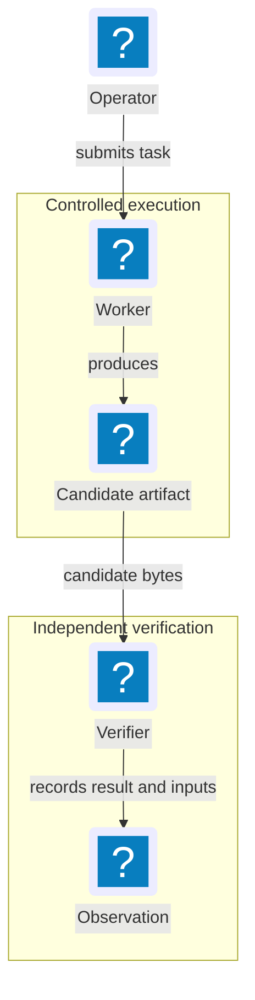

# Mermaid: semantic models and professional delivery

Use Mermaid as editable source for relationships and behavior. Verify the actual
destination renderer/version before selecting features. Official references
consulted 2026-11-04: [flowcharts/icons](https://mermaid.js.org/syntax/flowchart.html),
[icon registration](https://mermaid.js.org/config/icons.html),
[theming](https://mermaid.js.org/config/theming.html) and
[accessibility](https://mermaid.js.org/config/accessibility.html).
Live documentation does not prove a particular Markdown host's support.

## Select the model

| Reader question | Model | Semantic checks |
| --- | --- | --- |
| Who owns/connects to what? | Architecture or grouped component view | Ownership/trust/process boundaries and relationship meaning |
| What happens in what order? | Sequence | Participants, calls/results, cancellation, timeout and errors |
| Which transitions are valid? | State | Initial/terminal states, guards and rejected transitions |
| How does a process branch? | Flowchart | Named conditions, outcomes and recovery |
| How is data related? | ER/class where appropriate | Cardinality, optionality and source-defined fields |
| How do measured values compare? | Data plot | Real inputs, units, baseline and uncertainty; see media-and-data.md |

Do not turn every API into a flowchart or put a whole system into one figure.
Architecture-beta, custom icons, layouts and themes are renderer-dependent.
Choose supported syntax or a verified export rather than guessing compatibility.

## Separate model from style

Establish truthful nodes/edges/states first. Keep stable IDs independent of labels,
label ambiguous edges, group by ownership/responsibility and use a consistent
principal direction. Explain dashed lines. Distinguish planned/implemented elements
in text as well as styling. Do not omit errors to make a tidy happy-path picture.

Apply shared theme tokens/classes rather than per-node arbitrary styling. A
supported `base` theme can specify hex colors, font stack, line/text colors and
grouping. Check generated contrast: defaults and derived colors do not guarantee
it. Markdown hosts may ignore per-diagram config. Pin export configuration; never
weaken securityLevel to make custom HTML, styling or icons work.

## Professional component icons

Use a verified licensed SVG pack registered by the renderer, with consistent
optical weight and visible labels. Flowchart icon/image nodes require Mermaid
11.3.0+ and actual host support. Naming an icon in Markdown does not load its
pack. Check that every referenced icon exists. Shapes still encode decisions
and process semantics; a designed architecture view also uses coherent role
icons and grouped layout rather than generic boxes or emoji as its final design.

This **illustrative source** assumes a pack registered under `lucide` with these
icons. It is not a product architecture or a universally renderable Markdown
fence. Inspect the chosen pack's version/license and renderer before use:

Use this as a modeling seed; apply the host's theme and inspect the result. Where
the host cannot register icons, render in a controlled build and embed a
self-contained SVG (PNG only where needed), preserving the .mmd source and text
equivalent. An icon-free fence can be a labeled compatibility view; it does not
silently satisfy a requested rich visual. If rendering/export is unavailable,
deliver source and mark visual delivery unverified. Never invent an export path.

## Render and verify

1. Discover existing render/build commands. Record renderer/version/config,
   fonts and icon-pack version/license. Installation is not automatic.
2. Parse, then render separately. With an installed Mermaid CLI, an illustrative
   command is `mmdc -i figure.mmd -o figure.svg -c mermaid.json`. It does not
   automatically register every pack: inspect the CLI's supported registration
   mechanism or use a local renderer with explicit registration.
3. Treat parse errors, missing icons, font/network failures and empty exports as
   failures. Inspect SVG viewBox/dimensions, text, accessibility and external
   references, then view its actual embedded output. Parsing is not visual review.
4. Apply visual-quality.md at effective size, supported themes and export targets.
   Split/change direction/provide detail instead of hiding necessary branches.
5. Keep source/config and exports linked through a reproducible build. Record
   source/output identities; re-render and inspect when model, renderer, fonts,
   pack or theme changes.

Use accTitle/accDescr where supported. SVG title/desc do not replace an embedded
image's useful alt, caption and nearby explanation. Do not upload private sources
to public editors, load remote icon/font CDNs or disable sanitization for cosmetic
convenience. Offline exports must retain paths/styles without runtime fetches.
