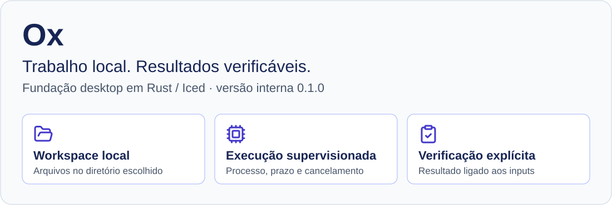
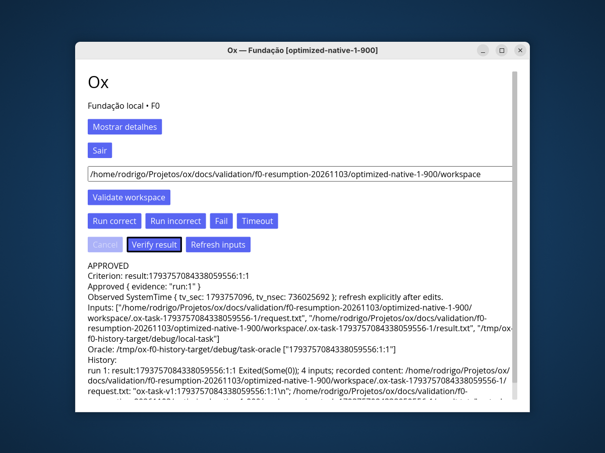
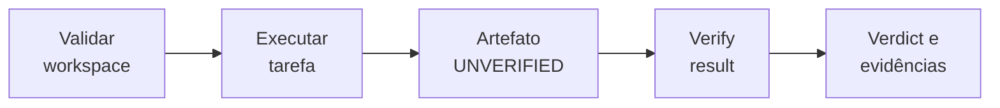
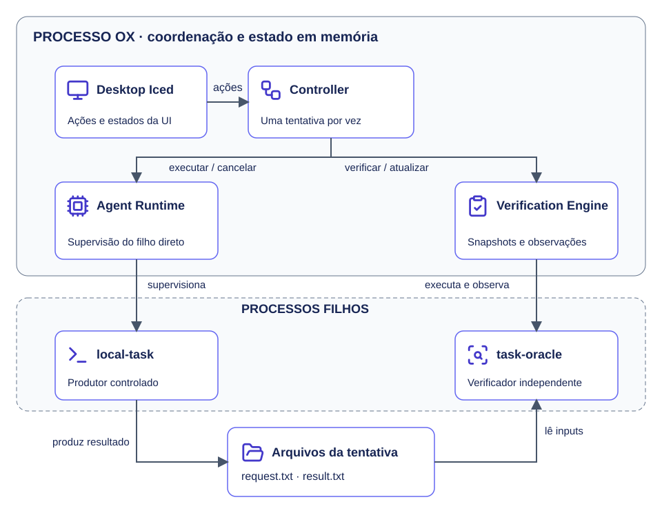

# Ox

**Uma fundação desktop para coordenar tarefas e agentes em projetos locais.**



[Primeiro uso](#primeiro-uso) · [Aplicação em imagens](#aplicação-em-imagens) ·
[O que está disponível](#o-que-está-disponível) · [Documentação](#documentação) ·
[Desenvolvimento](#desenvolvimento)

## Conheça o projeto

O Ox é **agent-first, local-first e extensível**. A direção do produto conecta
agentes, contexto de código, plugins e evidências sob controle do usuário.
Hoje, a entrega executável é uma **tarefa local controlada**, com interface Iced,
supervisão de processo e verificação independente do artefato.

> **Estado da entrega:** versão interna **0.1.0**, fase `implementation-foundation`,
> aplicativo `bootstrap-implemented`. F0 foi aceito no corpus local Linux x86_64
> adotado, com X11 e Wayland avaliados separadamente. A aprovação tem os
> [limites registrados](docs/validation/f0-resumption-20261103/report.md).

### Aplicação em imagens

[](docs/assets/ox-approved.png)

*Captura real da fundação: tarefa correta após verificação. Registro Wayland do
corpus F0 de 03/11/2026, reutilizado sem edição; não é mockup nem nova execução.*
[Origem e licença dos visuais](docs/assets/README.md).

### O que está disponível

| Área | Entrega atual | Limite |
| --- | --- | --- |
| Desktop | Janela Iced, teclado, workspace e estados | Uma operação por vez |
| Tarefa local | Correta, incorreta, falha, timeout e cancelamento | Fixture determinística, sem agente de IA |
| Supervisão | Processo filho direto e eventos por tentativa | Sem sandbox ou captura de stdout/stderr |
| Verificação | Oráculo, snapshots, histórico e invalidação | Histórico em memória; atualização manual |
| Plugins | Host Unix com protocolo textual 1.0 e grant de echo | API independente da interface |
| Fundação | Workspace com 16 crates e contratos de domínio | Contratos não são motores completos |

Agentes reais, persistência durável, indexação, motores de grafo, compactação de
output, LSP por plugins e distribuição pública continuam planejados. Consulte a
[arquitetura](docs/architecture/application.md) para distinguir implementação e direção.

## Primeiro uso

### 1. Compile e abra

Requer **Linux x86_64**, sessão **X11 ou Wayland**, Rust/Cargo **1.99.1** e as
bibliotecas de sistema necessárias a Iced/winit. O
[toolchain](application/rust-toolchain.toml) fixa rustfmt e clippy. Tenha as
dependências do lockfile em cache ou acesso autorizado para obtê-las.

Na raiz do repositório:

```bash
cd application
cargo build --workspace --locked
cargo run --locked -p ox-app --bin ox
```

O build prepara `ox`, `local-task` e `task-oracle` em `target/debug/`.
**Mantenha os três juntos.** Não há instalador público nem uma lista universal de
pacotes Linux. O [guia de execução](application/README.md) trata cache e problemas.

### 2. Execute e verifique

1. Escolha um diretório de demonstração existente e gravável; clique em
   **Validate workspace**.
2. Clique em **Run correct**. O artefato produzido ainda fica `UNVERIFIED`.
3. Clique em **Verify result**. Identidade, resultado 42 e observação aplicável
   podem sustentar `APPROVED`.
4. Compare com **Run incorrect** e depois **Verify result**: o produtor pode sair
   com sucesso, mas o artefato incorreto é `REJECTED`.

[](docs/assets/task-cycle.svg)

*O ciclo separa execução de aceitação.* [Abrir a figura](docs/assets/task-cycle.svg).
O [fluxograma detalhado](application/README.md#usar-a-demonstração) mostra recusas,
resultados incorretos e evidência insuficiente.

<details>
<summary>Diagrama Mermaid — fonte editável</summary>



</details>

Cada tentativa cria `.ox-task-<sessão>-<tentativa>/` com pedido e eventual resultado.
Os arquivos permanecem após sair. O histórico e as aprovações em memória se perdem
ao reiniciar. Após editar inputs, use **Refresh inputs**; não há watcher automático.

## Como a fundação se conecta

[](docs/assets/architecture.svg)

*Componentes executados no fluxo local. O Plugin Host continua separado da UI.* [Abrir em tamanho integral](docs/assets/architecture.svg).

[Fonte Mermaid com ícones Lucide](docs/assets/diagrams/architecture.mmd).

O Desktop recebe ações; o Controller coordena a tentativa. O Runtime supervisiona
o produtor e o Engine observa o oráculo. Os arquivos ligam produção e verificação.
A [visão de arquitetura](docs/architecture/application.md) explica fronteiras,
workers, contratos e os 16 crates.

## Desenvolvimento

Em `application/`, após compilar os auxiliares:

```bash
cargo test --workspace --locked
cargo fmt --all -- --check
cargo clippy --workspace --all-targets --locked -- -D warnings
```

Testes comuns cobrem contratos e processos locais. Os seis testes desktop ignorados
exigem sessão X11 dedicada; as [instruções](application/README.md#testes-e-referência-rust)
detalham interação e limites. Os checks Python verificam
[governança](docs/development/governance.md), com escopo próprio.

Antes de contribuir, leia [AGENTS.md](AGENTS.md), a [constituição](docs/constitution.md),
o [contexto autorizado](sdd/project.md) e o [workflow SDD](sdd/workflow.md).

## Documentação

| Quero… | Comece aqui |
| --- | --- |
| Executar e experimentar a UI | [Guia da aplicação](application/README.md) |
| Encontrar os guias e suas figuras | [Mapa da documentação](docs/README.md) |
| Entender componentes e implementações | [Arquitetura](docs/architecture/application.md) |
| Consultar estados, inputs e protocolo | [Contratos](docs/architecture/contracts.md) |
| Verificar governança e preservar histórico | [Desenvolvimento](docs/development/governance.md) |
| Copiar ou recuperar governança | [Compartilhamento](docs/development/sharing.md) |
| Retomar uma entrega | [Features SDD](sdd/features/README.md) |
| Selecionar um método de desenvolvimento | [31 skills](.codex/skills/README.md) e [pontes](sdd/chain/README.md) |

A biblioteca de skills apoia o desenvolvimento do Ox. O desktop atual não carrega
skills dos projetos do usuário. Disponibilidade, seleção, consulta e uso são estados
distintos, descritos na [integração SDD/skills](docs/development/sdd-skills.md).

## Compartilhamento e licença

`application/Cargo.toml` define o produto. O pacote `ox-governance.zip` declara
`product_included=false`: inclui governança, sem `application/`, binários ou
instaladores. O pipeline do aplicativo exige build, testes e distribuição próprios.

Material próprio: **GPL-3.0-only**, Rodrigo Batista. Veja [LICENSE](LICENSE),
[NOTICE](NOTICE) e a [revisão local de licenciamento](docs/licensing/review.md).
Direitos de materiais copiados e condições de distribuição pública permanecem pendentes.
A expressão histórica `not-yet-implemented` descreve o início do projeto.

---

[Visuais, fontes Mermaid e reprodução](docs/assets/README.md) ·
[Revisão visual e verificações](docs/validation/documentation-visuals-20261104/report.md)
