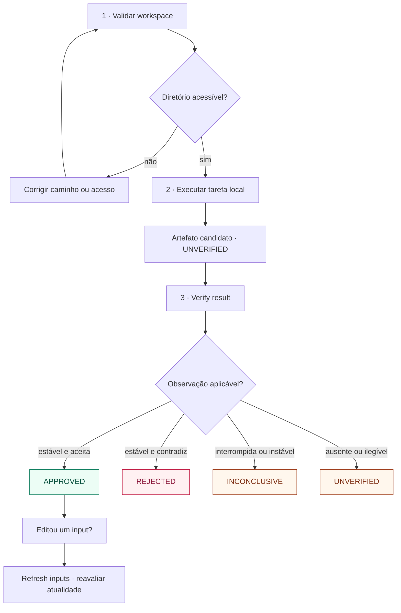
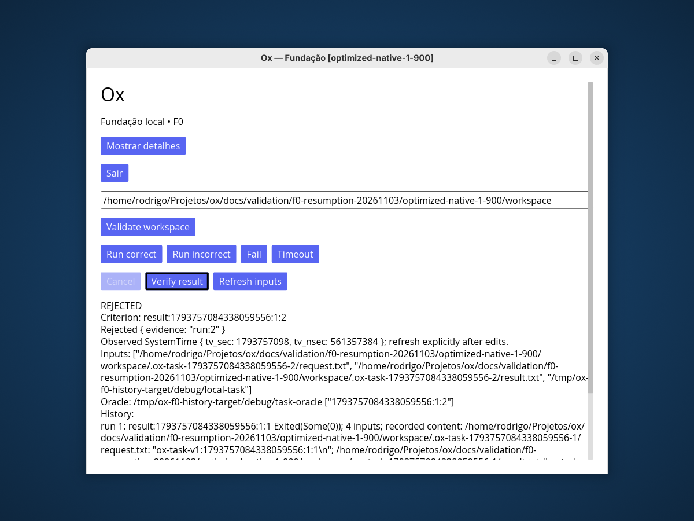

# Aplicação Ox

Workspace Cargo virtual da fundação desktop do Ox, versão interna 0.1.0.
Contém 16 crates, o shell Iced e fatias locais de supervisão, plugins e verificação.
Este guia parte da raiz do repositório; para conhecer o produto, veja o
[README principal](../README.md).

[Preparar](#preparar-e-executar) · [Demonstração](#usar-a-demonstração) ·
[Problemas](#resolver-problemas-de-primeiro-uso) · [Testes](#testes-e-referência-rust)

## A demonstração em duas observações

[](../docs/assets/ox-approved.png)

*Captura real do corpus Wayland F0 de 03/11/2026. A aprovação vem depois da ação
Verify result; terminar o processo não basta. A imagem conserva os bytes originais.*

## Preparar e executar

Ambiente adotado: Linux x86_64, Rust/Cargo 1.99.1 e sessão X11 ou Wayland.
[Cargo.toml](Cargo.toml) define edition 2024, piso declarado Rust 1.99 e Iced
=0.14.0. Esse piso não é uma demonstração do mínimo técnico suportado.
[rust-toolchain.toml](rust-toolchain.toml) fixa o compilador, rustfmt e clippy;
[Cargo.lock](Cargo.lock) registra as dependências.

Tenha as dependências disponíveis em cache ou acesso autorizado para obtê-las,
além das bibliotecas de sistema exigidas por Iced/winit. A lista de pacotes não
foi validada para todas as distribuições Linux.

```bash
cd application
cargo build --workspace --locked
cargo run --locked -p ox-app --bin ox
```

Para um cache já preparado, acrescente `--offline` a build, run e testes.
`--locked` impede atualizar o lockfile, mas não impede downloads. Um erro de
cache em modo offline exige disponibilizar as dependências antes de repetir.

O build do workspace gera os três binários usados pela demonstração:

| Binário em `target/debug/` | Papel |
| --- | --- |
| `ox` | Interface desktop |
| `local-task` | Produtor controlado do artefato |
| `task-oracle` | Verificador independente do resultado |

A UI procura os auxiliares ao lado do próprio executável. Compilar somente
`ox-app` não prepara necessariamente os outros dois. Ao usar outro perfil ou
diretório de build, mantenha os três juntos.

## Usar a demonstração

Escolha um diretório local de demonstração existente, acessível e gravável.
A validação confere diretório e leitura; a escrita é exercida pela execução.

| Ação na janela | Observação esperada |
| --- | --- |
| **Validate workspace** | Habilita execução se o diretório puder ser validado |
| **Run correct** | Produz `result=42`; permanece `UNVERIFIED` antes de verificar |
| **Verify result** após o cenário correto | Pode aprovar se identidade, oráculo e inputs permanecerem válidos |
| **Run incorrect**, depois **Verify result** | Rejeita `result=41`, apesar da saída bem-sucedida do produtor |
| **Fail** | Exercita término com falha |
| **Timeout** | Exercita o prazo do processo controlado |
| **Cancel** durante uma operação | Solicita cancelamento do processo em andamento |
| **Refresh inputs** | Reavalia a atualidade da evidência pelos bytes dos inputs |

Cada tentativa usa um diretório exclusivo `.ox-task-<sessão>-<tentativa>/`, contendo
`request.txt` e, quando produzido, `result.txt`. Não há monitoramento automático:
após editar um artefato, use **Refresh inputs**. Uma aprovação anterior não vale
para inputs alterados. Falha ou interrupção podem deixar somente o pedido.

**Sair** e fechar a janela solicitam cancelamento e aguardam a operação encerrar.
Os arquivos de tentativa permanecem no workspace. Reiniciar perde o histórico em
memória e não recupera as aprovações a partir desses arquivos.
A [reprodução detalhada](../docs/validation/product-local-task-ui/reproduce.md)
e a [referência de contratos](../docs/architecture/contracts.md) descrevem os casos.


[](../docs/assets/first-run.svg)

*O ciclo inclui recusa do workspace e reavaliação dos inputs, além do caminho correto.* [Abrir em tamanho integral](../docs/assets/first-run.svg).

<details>
<summary>Diagrama Mermaid — fonte editável</summary>



</details>

### Resultado incorreto também é um cenário esperado

[](../docs/assets/ox-rejected.png)

*Outra captura do mesmo corpus: o oráculo contradiz o artefato produzido. Uma
rejeição observada é diferente de não ter observação. Consulte a
[proveniência das capturas](../docs/assets/README.md#capturas-reais).*

## Resolver problemas de primeiro uso

| Sintoma | Conferir / próximo passo |
| --- | --- |
| Workspace recusado | Caminho existente, diretório e permissão de leitura; a edição do campo invalida a seleção anterior |
| Erro ao criar pedido ou resultado | Permissão de escrita e mensagem retornada pela operação; os arquivos usam criação exclusiva |
| Auxiliar ausente | Executar o build do workspace e conferir os três binários no mesmo diretório |
| Falha ao abrir a janela | Sessão gráfica e variáveis de display; examinar o erro do processo |
| Verificação recusada ou desatualizada | Identidade da tentativa, bytes dos artefatos e estado do oráculo; não deduzir aceitação do exit code do produtor |

Não há execução de prompts ou comandos arbitrários, provedor remoto, sandbox,
captura de stdout/stderr pelo runtime ou persistência durável. O host de plugins
é uma API independente da UI. Esses limites importam ao interpretar resultados
da demonstração e dos testes.

## Testes e referência Rust

Execute em `application/`, depois do build dos auxiliares:

```bash
cargo check --workspace --locked
cargo fmt --all -- --check
cargo test --workspace --locked
cargo test --workspace --locked -- --list
cargo clippy --workspace --all-targets --locked -- -D warnings
cargo doc --workspace --no-deps --locked
```

A referência Rust é gerada em `target/doc/`. Testes de processos e sockets Unix
precisam das permissões correspondentes. A suíte comum não executa os seis testes
desktop marcados como ignorados. Somente em sessão X11 dedicada:

```bash
cargo test --locked -p ox-app --test desktop -- --ignored --nocapture --test-threads=1
```

Esse comando move o ponteiro e interage com janelas. A aceitação Wayland tem
[observações próprias](../docs/validation/f0-resumption-20261103/report.md);
sucesso da suíte comum não substitui essa verificação gráfica.

## Navegar no código

Cada crate mantém fontes em `crates/<nome>/src/` e testes externos, quando
presentes, em `crates/<nome>/tests/`. Não há crate na raiz do workspace.

- [Arquitetura e 16 responsabilidades](../docs/architecture/application.md).
- [Contratos e links para implementação/testes](../docs/architecture/contracts.md).
- [Marcos e direção](../docs/architecture/context.md).
- [Política de atualização de versões](../docs/decisions/version-update-policy.md).
- [Features do produto](../sdd/features/README.md#ox-product).

Atualize este guia quando mudarem build, auxiliares, ações da UI, testes ou
ambiente suportado. Responsabilidade: contribuinte da mudança e mantenedor.
A [revisão visual](../docs/validation/documentation-visuals-20261104/report.md)
distingue os comandos executados dos apenas conferidos no código.
