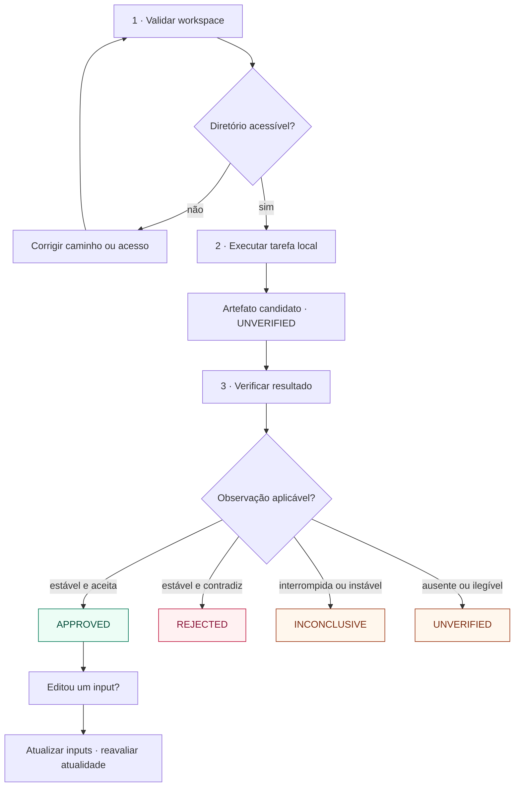
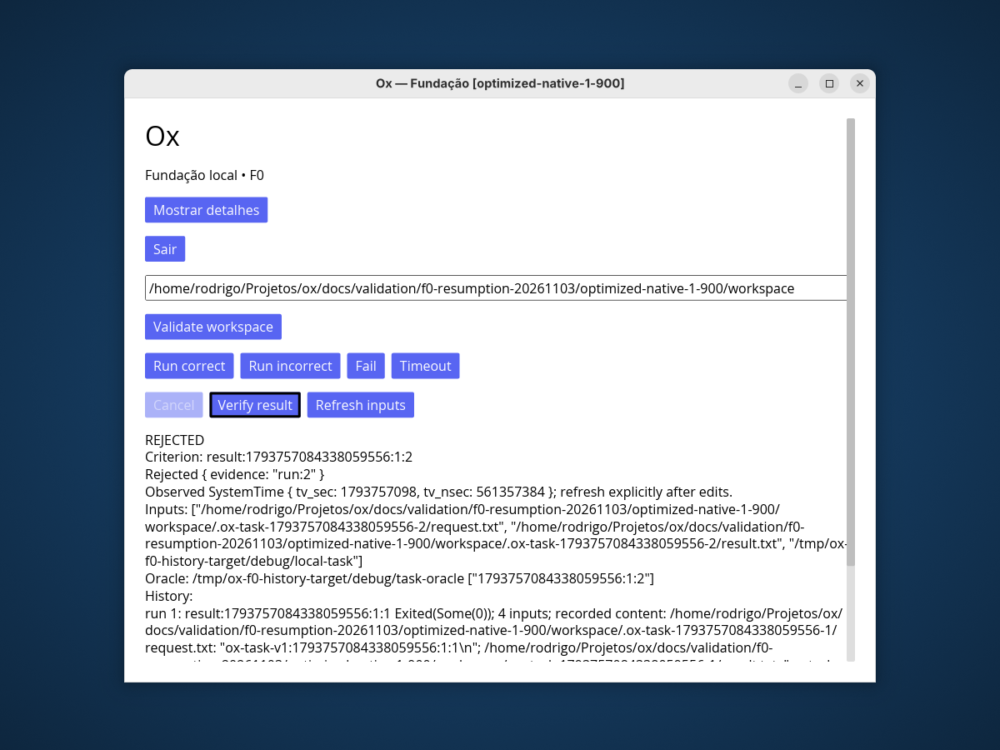

# Aplicação Ox

Workspace Cargo virtual da fundação desktop do Ox, versão interna 0.1.0.
Contém 16 crates, o shell Iced e fatias locais de supervisão, plugins e verificação.
Este guia parte da raiz do repositório; para conhecer o produto, veja o
[README principal](../README.md).

[Preparar](#preparar-e-executar) · [Demonstração](#usar-a-demonstração) ·
[Problemas](#resolver-problemas-de-primeiro-uso) · [Testes](#testes-e-referência-rust)

## A demonstração em duas observações

[](../docs/assets/ox-approved.png)

*Captura real do corpus Wayland F0 de 03/11/2026. A aprovação vem depois da ação
Verificar resultado; terminar o processo não basta. A imagem conserva os bytes originais.*

## Preparar e executar

Ambiente adotado: Linux x86_64, Rust/Cargo 1.99.1 e sessão X11 ou Wayland.
[Cargo.toml](Cargo.toml) define edition 2024, piso declarado Rust 1.99 e Iced
=0.14.0. Esse piso não é uma demonstração do mínimo técnico suportado.
[rust-toolchain.toml](rust-toolchain.toml) fixa o compilador, rustfmt e clippy;
[Cargo.lock](Cargo.lock) registra as dependências.

Tenha as dependências disponíveis em cache ou acesso autorizado para obtê-las,
além das bibliotecas de sistema exigidas por Iced/winit. A lista de pacotes não
foi validada para todas as distribuições Linux.

```bash
cd application
cargo build --workspace --locked
cargo run --locked -p ox-app --bin ox
```

Para um cache já preparado, acrescente `--offline` a build, run e testes.
`--locked` impede atualizar o lockfile, mas não impede downloads. Um erro de
cache em modo offline exige disponibilizar as dependências antes de repetir.

O build do workspace gera os três binários usados pela demonstração:

| Binário em `target/debug/` | Papel |
| --- | --- |
| `ox` | Interface desktop |
| `local-task` | Produtor controlado do artefato |
| `task-oracle` | Verificador independente do resultado |

A UI procura os auxiliares ao lado do próprio executável. Compilar somente
`ox-app` não prepara necessariamente os outros dois. Ao usar outro perfil ou
diretório de build, mantenha os três juntos.

## Usar a demonstração

Em Boas-vindas, use **Abrir pastas…** para escolher um diretório local de
demonstração existente, acessível e gravável. Depois entre em **Tarefas**.
A abertura valida diretório e leitura; a escrita é exercida pela execução.

| Ação na janela | Observação esperada |
| --- | --- |
| **Validar diretório** | Habilita execução se o diretório puder ser validado |
| **Executar correto** | Produz `result=42`; permanece `UNVERIFIED` antes de verificar |
| **Verificar resultado** após o cenário correto | Pode aprovar se identidade, oráculo e inputs permanecerem válidos |
| **Executar incorreto**, depois **Verificar resultado** | Rejeita `result=41`, apesar da saída bem-sucedida do produtor |
| **Provocar falha** | Exercita término com falha |
| **Exercitar prazo** | Exercita o prazo do processo controlado |
| **Cancelar operação** durante uma operação | Solicita cancelamento do processo em andamento |
| **Atualizar inputs** | Reavalia a atualidade da evidência pelos bytes dos inputs |

Cada tentativa usa um diretório exclusivo `.ox-task-<sessão>-<tentativa>/`, contendo
`request.txt` e, quando produzido, `result.txt`. Não há monitoramento automático:
após editar um artefato, use **Atualizar inputs**. Uma aprovação anterior não vale
para inputs alterados. Falha ou interrupção podem deixar somente o pedido.

**Sair** e fechar a janela solicitam cancelamento e aguardam a operação encerrar.
Os arquivos de tentativa permanecem no workspace. Reiniciar perde o histórico em
memória e não recupera as aprovações a partir desses arquivos.
A [referência de contratos](../docs/architecture/contracts.md) descreve os casos.


[](../docs/assets/first-run.svg)

*O ciclo inclui recusa do workspace e reavaliação dos inputs, além do caminho correto.* [Abrir em tamanho integral](../docs/assets/first-run.svg).

<details>
<summary>Diagrama Mermaid — fonte editável</summary>



</details>

### Resultado incorreto também é um cenário esperado

[](../docs/assets/ox-rejected.png)

*Outra captura do mesmo corpus: o oráculo contradiz o artefato produzido. Uma
rejeição observada é diferente de não ter observação. Consulte a
[proveniência das capturas](../docs/assets/README.md#capturas-reais).*

## Resolver problemas de primeiro uso

| Sintoma | Conferir / próximo passo |
| --- | --- |
| Workspace recusado | Caminho existente, diretório e permissão de leitura; a edição do campo invalida a seleção anterior |
| Erro ao criar pedido ou resultado | Permissão de escrita e mensagem retornada pela operação; os arquivos usam criação exclusiva |
| Auxiliar ausente | Executar o build do workspace e conferir os três binários no mesmo diretório |
| Falha ao abrir a janela | Sessão gráfica e variáveis de display; examinar o erro do processo |
| Verificação recusada ou desatualizada | Identidade da tentativa, bytes dos artefatos e estado do oráculo; não deduzir aceitação do exit code do produtor |

Não há execução de prompts ou comandos arbitrários, provedor remoto, sandbox,
captura de stdout/stderr pelo runtime ou persistência durável de tarefas/evidências.
A lista de projetos recentes tem persistência local delimitada, descrita abaixo. O host de plugins
é uma API independente da UI. Esses limites importam ao interpretar resultados
da demonstração e dos testes.

## Testes e referência Rust

Execute em `application/`, depois do build dos auxiliares:

```bash
cargo check --workspace --locked
cargo fmt --all -- --check
cargo test --workspace --locked
cargo test --workspace --locked -- --list
cargo clippy --workspace --all-targets --locked -- -D warnings
cargo doc --workspace --no-deps --locked
```

O patch local de `cryoglyph` corrige a dependência `lru` e preserva os layouts de
bytes usados pelo renderer opcional. Veja a [decisão e os limites](../docs/decisions/locked-lru-remediation.md)
e o [aviso do patch](vendor/cryoglyph-0.1.0/OX-PATCH.md). O vendor fica fora dos
membros do workspace; `cargo test --workspace` não executa seus testes de layout.
Da raiz do Ox, execute também:

```bash
CARGO_HOME="$PWD/.cache/ox/cargo-home" \
  python3 application/tools/test_vendor_layout.py --output /tmp/ox-vendor-layout-new-run
```

Escolha um diretório de relatório ainda inexistente, fora de `application/`.
São necessários o toolchain fixado já instalado e o cache das dependências. A
entrada não instala toolchain nem baixa crates: compila `iced/wgpu-bare` com
`--locked --offline`, executa todos os testes da biblioteca cryoglyph vendorizada e confirma
duas rejeições de layouts inválidos. Preserva comandos, streams, exits e identidades
das fontes/binários, e rejeita testes obrigatórios omitidos/ignorados/filtrados ou
inputs alterados. Artefatos compilados ficam em `target/vendor-layout` (ou no
`CARGO_TARGET_DIR` explícito), separados do relatório. Esse comando é uma entrada
separada do runner completo e é obrigatório para alterações deste patch; não
executa exemplos/benchmarks upstream nem comprova funcionamento gráfico em GPU.

O patch de [PNG 0.18.1](vendor/png-0.18.1/OX-PATCH.md) remove somente uma
dependência direta sem uso no codec. Os quatro testes `png_assets` fazem parte
de `cargo test --workspace`: fixture RGBA independente, roundtrip, rejeições de
streams inválidos e leitura dos assets de identidade. Isso não executa a suíte
upstream inteira: seu corpus não acompanha o pacote publicado e as dependências
de desenvolvimento não estão todas no cache autorizado. O código do codec, os
testes e as licenças upstream permanecem preservados.

A referência Rust é gerada em `target/doc/`. Testes de processos e sockets Unix
precisam das permissões correspondentes. A suíte comum não executa os seis testes
desktop marcados como ignorados. Somente em sessão X11 dedicada:

```bash
cargo test --locked -p ox-app --test desktop -- --ignored --nocapture --test-threads=1
```

Esse comando move o ponteiro e interage com janelas. A aceitação Wayland foi
observada à parte, no corpus F0 de 03/11/2026 em Mutter nativo isolado;
sucesso da suíte comum não substitui essa verificação gráfica.

## Navegar no código

Cada crate mantém fontes em `crates/<nome>/src/` e testes externos, quando
presentes, em `crates/<nome>/tests/`. Não há crate na raiz do workspace.

- [Arquitetura e 16 responsabilidades](../docs/architecture/application.md).
- [Contratos e links para implementação/testes](../docs/architecture/contracts.md).
- [Marcos e direção](../docs/architecture/context.md).
- [Política de atualização de versões](../docs/decisions/version-update-policy.md).
- [Specs vivas do produto](../sdd/specs/README.md).

Atualize este guia quando mudarem build, auxiliares, ações da UI, testes ou
ambiente suportado. Responsabilidade: contribuinte da mudança e mantenedor.

## Encerramento de alterações

Quando a tarefa autorizar verificações, a entrada vigente na raiz é
`./scripts/automate.sh run --surface application`: verificações Rust, cobertura
e ferramentas Cargo, além da governança obrigatória, com dependências offline e
lockfile preservado. `run --scope complete` inclui todas as superfícies e os
complementares; sua seleção depende dos critérios da tarefa. Veja os [limites e diagnóstico](../scripts/README.md). Aceitação gráfica
permanece separada. A limpeza de 09/11/2026 usou somente inspeção e não executou
esses comandos.

## Visual workbench

The native shell provides 27 current/planned destinations, Ctrl+K command search,
three session themes and two densities. See [DESIGN.md](../DESIGN.md) and the
[surface contracts](../docs/design/surfaces.md). Planned screens identify unavailable
backends. `python3 application/tools/build_design.py --check` from the repository
root checks generated roles. The isolated Mutter/PipeWire review scripts were removed
on 2026-11-23 with the legacy evidence they read; no isolated Wayland review command is
maintained. The X11 desktop suite above remains the only graphical command.

### Current native composition

Editor e arquivos and Modo de foco provide three build-embedded documents with
selectable file navigation/tabs, line numbers, an origin inspector and contextual
tools. They are read-only demonstrations, not files opened from the selected
workspace. Architecture shows declared Cargo dependencies; agent screens separate
roles from unavailable instances. Preferences remain session-only.

The isolated Mutter/Wayland composition review was removed on 2026-11-23 (see above).

The 2026-11-11 integration left clause-level semantic review, licensed icon adaptation,
graph pan/zoom, resizable panes, document editing and real services open
(`ea3cf0f:docs/validation/visual-integration-20261111/report.md`, Git history).
Its two native runs and 12 Rust tests do not establish X11 or assistive-technology
acceptance. Source coverage and component contracts remain linked from DESIGN.md.

## Tela inicial: começar ou retomar um projeto

A tela ocupa a janela com barra de contexto navy, painel de ações/projetos à
esquerda e área principal neutra. A coluna de ações ocupa 280 unidades lógicas
ou 210 abaixo de 900; ações e projetos têm rolagem independente. A assinatura Catalisador/Valência
integra a barra; o mascote foi retirado da interface. Formulário
de criação, navegação, preferências e seções compartilham a composição desktop.
Assets definitivos e IBM Plex estão incorporados ao executável; `.local/assets`
não é uma dependência de execução.
O layout foi observado em Wayland nativo a 640×480, 1440×900 e 2560×1080 em 17/11/2026,
sem observação X11 ou de tecnologia assistiva.

A página de boas-vindas oferece **Novo projeto**, **Abrir pastas…**, **Clonar
repositório** (indisponível) e **Projetos recentes**. O seletor gráfico valida o
diretório escolhido e abre o projeto. Falha do seletor revela e foca um campo manual
de recuperação na coluna de ações. Essa transição foi corrigida em 17/11 após a
auditoria identificar que o diagnóstico aparecia com o campo ainda oculto; o teste
de regressão agora parte de `FolderChosen(Err)`. Cancelamento mantém o projeto anterior.
Abrir ou criar um projeto não executa tarefas, agentes ou comandos.
**Configurações** abre as preferências atuais; temas/densidade continuam de sessão.

O foco por Tab revela temas/densidade no painel de Configurações e ações no painel
de boas-vindas correspondente. Ctrl+B, Ctrl+K e Ctrl+Alt+setas ficam restritos à
bancada e respeitam eventos capturados por campos de texto. As mensagens próprias
da tarefa/verificação usam pt-BR; identificadores, caminhos, conteúdo bruto e
diagnósticos externos preservam seus valores originais.

**Novo projeto** pede nome e caminho absoluto de uma pasta de destino existente, mostra o destino completo
e a consequência antes de **Criar e abrir**. A operação cria somente uma pasta
vazia; não gera arquivos, inicializa Git ou baixa dependências. Nomes que escapem
da pasta-pai e destinos já existentes (inclusive links e arquivos) são recusados.
**Cancelar** antes da confirmação não altera arquivos. Se a pasta for criada e a
abertura falhar, ela é preservada e o diagnóstico orienta abri-la como pasta existente.

Os recentes contêm até 20 caminhos reais, com nome e caminho visíveis, ordenados pela
última abertura bem-sucedida. Reabrir um caminho já registrado o move para o início;
a identidade usa o caminho absoluto canônico. Clique no projeto para reabrir e validar
novamente. Caminhos movidos ou indisponíveis permanecem na lista com feedback
recuperável ao tentar abrir. **Remover** retira somente o registro, sem apagar o projeto.
Reiniciar carrega a lista e não reabre nem executa projetos automaticamente.

O histórico fica em `$XDG_STATE_HOME/ox/recent-projects.v1`; sem XDG_STATE_HOME,
usa `$HOME/.local/state/ox/recent-projects.v1`. O diretório de estado deve ser absoluto.
O formato versionado limita 20 registros e 16 KiB por caminho UTF-8. O arquivo `.lock`
serializa operações cooperativas; falhas/ocupação são informadas e não impedem abrir
um projeto. **Tentar novamente** relê o histórico. **Redefinir histórico…** exige
confirmação e esvazia a lista; dados corrompidos dentro do limite são preservados
em arquivo `.corrupt-backup-*`. Arquivos grandes demais ou de versões futuras
permanecem intactos e a redefinição é recusada, exigindo recuperação manual/versão
compatível. Esta persistência não armazena tarefas, resultados, aprovações ou preferências.

O seletor gráfico usa o programa GTK `zenity`, instalado separadamente e disponível
no PATH (observado localmente: 4.2.2). O Ox não o instala automaticamente. Se não
estiver disponível ou falhar, a entrada manual continua acessível. Cancelar o diálogo
preserva o caminho e o trabalho anterior. Apenas um diálogo é aberto por vez;
mudar de contexto ou encerrar o Ox solicita seu encerramento supervisionado.
Nomes sem representação UTF-8 são recusados sem conversão silenciosa.

A boas-vindas foi aceita em 14/11/2026 só com armazenamento local cooperativo Linux e
Mutter Wayland isolado em escala 1, sem AT, X11, DPI fracionário, ENOSPC ou NFS.

Em Configurações/Aparência, tema e densidade têm prévia. **Salvar** confirma
para a sessão e retorna à origem; **Voltar**/Esc descarta a prévia. Os atalhos
de tema/densidade na barra do workbench aplicam diretamente à sessão.

A barra superior usa ícones com identificação ao passar o mouse ou navegar pelo
teclado. Arraste o divisor lateral para ajustar a largura do painel. **Ctrl+B**
recolhe/expande a navegação; os botões de reduzir/ampliar no cabeçalho lateral
também funcionam com Tab e Enter. A faixa recolhida mantém os destinos com dicas.
A largura é lembrada somente nesta sessão. O mascote não é exibido na interface.

A barra de projetos ocupa a altura disponível e oferece Plugins na base, levando
à tela existente de ferramentas/plugins (integração de plugins ainda indisponível).
