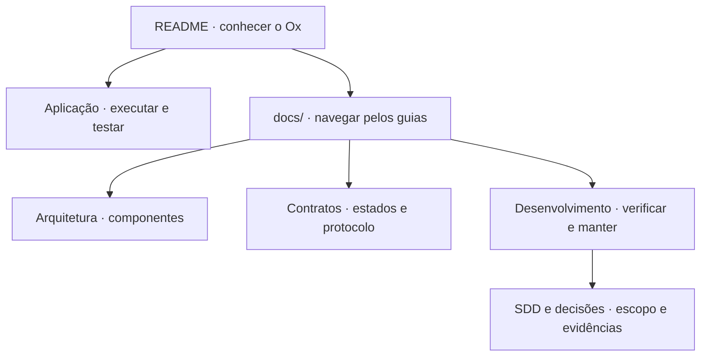

# Documentação do Ox

Comece pelo [README principal](../README.md) para conhecer o estado do produto,
ou pelo [guia da aplicação](../application/README.md) para executar a tarefa local.
Este índice organiza a documentação mantida; registros históricos conservam a
situação observada na data de cada execução.

*Cada entrada responde a uma pergunta; políticas e observações históricas mantêm sua autoridade.* [Abrir em tamanho integral](assets/documentation.svg).

Diagrama Mermaid — fonte editável

## Galeria de explicações

| Quero enxergar… | Figura e explicação |
| --- | --- |
| A interface em funcionamento | [Primeiro uso](../application/README.md#a-demonstração-em-duas-observações) |
| Os componentes e as fronteiras | [Arquitetura local](architecture/application.md#visão-dos-componentes) |
| A ordem entre produção e verificação | [Sequência de execução](architecture/application.md#sequência-de-uma-tentativa) |
| Os estados do supervisor | [Máquina de estados](architecture/contracts.md#estados-do-supervisor) |
| A negociação com um plugin | [Sequência do protocolo](architecture/contracts.md#sequência-do-protocolo) |
| A mudança virando evidência | [Etapas do workflow](../sdd/workflow.md#etapas) |
| As fontes, licenças e reprodução | [Acervo visual](assets/README.md) |

## Entender a aplicação

| Documento | Pergunta que responde |
| --- | --- |
| [Aplicação e implementações](architecture/application.md) | Como o fluxo funciona e o que cada crate implementa? |
| [Contratos](architecture/contracts.md) | Quais são os inputs, estados, efeitos, limites e erros? |
| [Contexto arquitetural](architecture/context.md) | Qual é a direção do produto e a sequência dos marcos? |
| [Fronteiras de confiança](security/trust-boundaries.md) | Onde estão os limites de confiança e as garantias ainda ausentes? |

## Desenvolver e verificar

| Documento | Uso |
| --- | --- |
| [Guia da aplicação](../application/README.md) | Build, primeiro uso, problemas e testes Rust/Iced |
| [Contexto e escopo vigente](../sdd/project.md) | Fase, permissões e entregas autorizadas |
| [Workflow](../sdd/workflow.md) | Escolher rota local ou completa e retomar trabalho |
| [Evidências](../sdd/workflow.md#evidência-e-retomada) | Registrar critérios, métodos, inputs, resultados e limites |
| [Specs vivas](../sdd/specs/README.md) | Estado e critérios de cada capacidade do produto |
| [Agentes](../sdd/workflow.md#agentes) | Triagem, perfis de complexidade, delegação e verificação no Ox |
| [Skills](../sdd/workflow.md#skills) | Selecionar e registrar métodos sem ativação automática |
| [Comandos](../sdd/project.md#comandos) | Checks do SDD e da governança, build e testes |
| [Automação local](../scripts/README.md) | Escopos Bash, scanners, configurações, preparo explícito de bases e limites offline |

## Consultar decisões

A [constituição](../sdd/constitution.md) contém as políticas permanentes;
[AGENTS.md](../AGENTS.md) aponta as instruções operacionais. ADRs detalham decisões
e propostas, respeitando seus estados e sucessores:

- [Modelo do SDD](decisions/sdd-model.md): autoridade, fluxo, agentes e remoção do legado.
- [Bootstrap](decisions/product-bootstrap.md): fundação e toolchain (Rust 1.99.1 fixado;
  `rust-version` 1.99 como piso declarado).
- [Fronteira F0](decisions/f0-boundary-20261102.md): corpus adotado e limites.
- [Atualização de versões](decisions/version-update-policy.md): avaliação e promoção.
- [Persistência local](decisions/local-persistence-proposal.md): proposta ainda sem implementação autorizada.
- [Decisões abertas](decisions/open-questions.md): escolhas pendentes.
- [Automação Bash](decisions/scripts-shell-refactor.md) e
  [segurança e qualidade](decisions/scripts-security-quality.md): organização,
  capacidades mantidas e limites dos checks.
- [Licenciamento](licensing/review.md): material próprio e direitos pendentes.

## Interpretar as evidências

A aceitação pertence aos critérios de cada [spec viva](../sdd/specs/README.md) e aos
inputs efetivamente observados. Aprovação de uma skill não demonstra funcionamento do
módulo de mesmo nome. Tasks novas registram evidência em `sdd/tasks/<ID>.md`. A evidência
anterior a 2026-11-23 só é recuperável pelo histórico do Git e não sustenta aprovação nova
([modelo do SDD](decisions/sdd-model.md)).

Mantenha este índice ao criar ou mover uma entrada de documentação. Atualize a
explicação canônica quando o código mudar.

## Manutenção do workspace

- [Artefatos locais](development/local-artifacts.md): caminhos de logs e caches,
  simulação e rotação de no máximo duas datas, sem backup, lixeira ou recibo.
  Essa retenção operacional não substitui a evidência das tasks nem o histórico do Git.
- [Decisão de manutenção](decisions/repository-maintenance.md).
- [Fechamento documental por tarefa](../sdd/workflow.md#9-fechar).

Visual contract: [DESIGN.md](../DESIGN.md); [surface map](design/surfaces.md); [decision](decisions/visual-workbench.md).

Current visual integration: [source coverage](design/reference-coverage.md),
[native components](design/components.md),
[state and remaining work](../sdd/specs/visual-workbench.md).
Task completion requires the [SDD documentation update rule](../sdd/workflow.md#9-fechar).

## Proveniência

- [Proveniência de cópias](licensing/copy-provenance.json): origem e bytes das skills e
  materiais copiados.
- [Inventário de licenças](licensing/license-inventory.json): marcadores de licença dos
  archives (2026-10-27).
