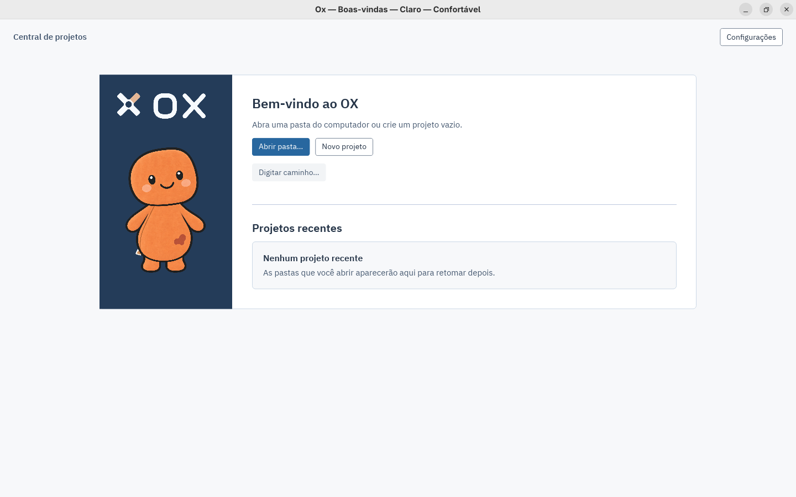

# Welcome identity and layout — 2026-11-16

## Scope and route

Request: refactor the native home page with the mascot, symbol and composition in
`.local/assets`. Source selected: `definitivo`, revision identidade-definitiva-01,
with algodao-etiqueta-vetorial-05. The source board and README were inspected.

Local route: recoverable presentation refactor; S01/S02 and their consumers are
known, with existing Controller/worker/message/focus contracts. No persistence,
authorization, concurrency, recovery or execution semantics are changed. Root
owns the affected UI, bundled assets, Cargo PNG support, feature documentation
and this observation directory. Existing unrelated edits are preserved.

## Criteria and intended composition

- Identity: use the supplied signature/symbol and unmodified tagged mascot,
  preserve proportions/transparency and source provenance; no runtime local-path
  dependency. Fixed navy/copper branding remains distinct from action/status.
- Layout: a restrained identity column and a primary project-entry area containing
  Open folder, New project, manual entry and real recent projects. Below 900 logical
  units, use a compact horizontal identity strip and stacked project sections.
  Keep 14–24 unit readable type, natural wrapping and one scrolling body.
- Behavior: preserve existing action IDs/messages, keyboard traversal, focus reveal,
  loading/error/reset feedback and Settings access. Opening a project alone must
  create no task output. Preserve creation confirmation and existing contents.

Risks: missing native PNG decoding, mascot dominating narrow windows, long paths
and focus below the fold. Verify PNG-only support with the pinned Iced 0.14.0 /
Rust 1.99.1 / edition 2024 / MSRV 1.99 workspace, focused UI tests and real private
Mutter captures/input. No full scanner, AT, platform or overall WC acceptance is
implied by this local observation.

## Methods actually consulted

Primary `.codex/skills/design-system/SKILL.md`: visual-composition, pattern-decisions
and accessibility references for region budgets, reuse and focus visibility.
Supporting `.codex/skills/iced-engineering/SKILL.md`, native-visual-contract:
native layout/adaptation and paired captures. Supporting `.codex/skills/rust/SKILL.md`:
manifest/toolchain/feature inspection and focused safe-Rust checks. Local route;
no bridge installation or specialist delegation.

## Observations

Baseline build: `CARGO_HOME="$PWD/.cache/ox/cargo-home" cargo build
--manifest-path application/Cargo.toml --locked --offline -p ox-app --bin ox`, exit 0.
Baseline capture: [before-native/initial.png](before-native/initial.png), actual
private Mutter, 1440×900 maximized outer window, Light/Comfortable, scale 1.

The sandboxed capture attempt `before` could not start the compositor because the
runtime directory was read-only. Its diagnostic is retained. The explicitly
approved host run succeeded. `after-wide`/`after-small` are preliminary observations:
their initial harness incorrectly tabbed past the auto-focused manual input,
so those runs did **not** establish a successful open despite the weak no-task
assertion. The harness was corrected to type into the input and require the actual
project path in the real history snapshot. Their bytes remain historical;
only `verified-*` below supplies final source-bound native observations.

## Final observed inputs and results

[inputs.json](inputs.json) records manifests, final Rust sources, embedded fonts,
consulted skill entries and all three source/copy asset identities. Copies are
byte-identical RGBA PNGs with alpha spanning 0–255. Original sources remain intact.
Iced remains 0.14.0, software tiny-skia; image 0.25.10 is resolved with PNG only.
All previously locked package name/version/source/checksum identities were retained.
Cargo also records optional GPU packages in its lockfile; `cargo tree -e normal`
confirms no wgpu in the active ox-ui dependency tree. Initial offline check lacked
image in cache; the normal network check acquired rendering dependencies and
passed. Later checks ran locked/offline. No toolchain/version migration.

Final Rust commands were run from `application/`, with
`CARGO_HOME="$PWD/../.cache/ox/cargo-home"` for Cargo builds/tests/clippy:

| Command | Observed result |
| --- | --- |
| `cargo build --locked --offline -p ox-app --bin ox` | exit 0 |
| `cargo test --locked --offline -p ox-ui` | exit 0; 41 unit + 4 local-task integration + 1 shell contract passed; one ignored subprocess helper is invoked by parent tests |
| `cargo clippy --locked --offline -p ox-ui --all-targets -- -D warnings` | exit 0 |
| `cargo fmt --all -- --check` | exit 0 |
| Root `PYTHONDONTWRITEBYTECODE=1 python3 sdd/tools/validate.py --root . --structure-only` | exit 0; structure only, not acceptance |
| `git diff --check` on the affected tracked product/design/feature/project paths | exit 0 |

Final native command: `python3 docs/validation/welcome-identity-20261116/native-check.py
--name verified-wide --exercise`, and `--name verified-small --monitor 640x480
--exercise`. Both exit 0, app closes naturally with exit 0, private Mutter 51.1,
Wayland/tiny-skia, scale 1, Comfortable. Wayland configure observations establish
1440×900 and 640×480 maximized outer windows, including decorations. Both use binary
SHA-256 `c81a020fbabecd66a8ef0a698f50036b9009e8d97eac3d51adaaa85bfdfbb672`.
Every source hash in both result files was compared with the final checkout:
exact match. Results/events/Wayland logs/captures remain beside each run.

| Scoped criterion | Method and observed result | Local state |
| --- | --- | --- |
| Identity | Source/copy byte/size/alpha comparison and inspection of actual Light/Dark/HC captures; supplied signature proportions, symbol, mascot/tag preserved; HC uses all-white signature | APPROVED |
| Layout | Paired same-geometry baseline/current wide captures; narrow initial, long wrapping recent path, focus and removal captures; no clipped action in the inspected regions, scroll reveal exposes focused recent/remove controls | APPROVED |
| Behavior preservation | Existing state/filesystem/widget/process tests; real keyboard manual opening requires actual history bytes; sentinel preserved, no `.ox-task-*`; recent path rendered; Settings/theme navigation and new-project form/Escape observed | APPROVED |

These are bounded **manual local-route** dispositions by root, not independent
feature validation. No assistive technology, fractional scale, X11, native picker
journey, full creation/restart/failure matrix, startup-performance or complete
scanner acceptance is claimed. Those wider WC-06 obligations were not rerun.
WC-01–06 therefore remain UNVERIFIED and wider AC-01–06 INCONCLUSIVE; original
historical evidence and its hashes were compared and preserved unchanged.

Final image: [wide home](verified-wide/initial.png).
Narrow keyboard evidence: [recent focus](verified-small/recent-keyboard-focus.png),
[remove focus](verified-small/remove-keyboard-focus.png).
Themes: [dark](verified-wide/dark.png), [high contrast](verified-wide/high-contrast.png).
Confirmation surface: [new-project form](verified-small/new-project-form.png).

## Documentation disposition and closure

Updated DESIGN.md (bounded S01 identity/geometry/brand roles),
docs/design/surfaces.md (current composition and unchanged effects),
docs/design/reference-coverage.md (definitive source/copy disposition),
application/README.md (entry appearance/assets/runtime behavior), embedded asset
README (provenance/Ferris attribution), sdd/project.md (current authorization),
and product-visual-workbench spec/plan/tasks/converge/evidence (scope, T022 and
preserved acceptance limits). This report records methods, criteria and observations.

Reviewed unchanged: docs/architecture/context.md and the bootstrap ADR, because
Controller/worker ownership, storage/task effects and platform/MSRV are unchanged;
docs/design/tokens.json and native generated tokens/fonts, because this adopts
supplied artwork without changing semantic theme roles or typography; root
README.md, whose explicitly historical F0 screenshot/commands remain accurate;
NOTICE and docs/licensing/review.md, whose material-own/third-party distinction
is retained, with the supplied artwork provenance recorded beside its copies.
No license policy, governance/gate implementation, commit or publication changed.

The requested local presentation work is complete within these observed limits.
