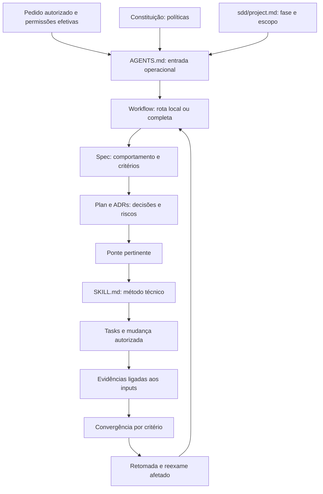

# Análise do Ox: skills, AGENTS.md e SDD

Data da inspeção: **3 de novembro de 2026**. Idioma: português brasileiro.

Este relatório explica a governança existente no Ox: quais são seus componentes, o que fazem, como se conectam, quais regras induzem no comportamento do agente e onde existem limites ou informações que exigem leitura histórica. É uma análise do conteúdo local observado, sem alterar as autoridades do projeto.

O estado analisado é a árvore de trabalho, incluindo arquivos modificados e não rastreados. O `HEAD` observado foi `68f8d072aa5656eb70c705e4bec5071a3afcff81`; esse identificador sozinho **não representa todos os bytes analisados**. Havia numerosas mudanças anteriores à análise. Somente este relatório foi criado por esta tarefa. Durante a redação, outro trabalho atualizou dez arquivos SDD e acrescentou registros F0; essas mudanças concorrentes foram preservadas e os estados afetados foram relidos antes da finalização.

## 1. Resultado principal

O projeto possui uma integração explícita entre três mecanismos:

| Mecanismo | Pergunta que responde | Responsabilidade |
| --- | --- | --- |
| `AGENTS.md` | Como o agente deve começar e se comportar neste repositório? | Entrada operacional, consulta às autoridades, preservação, autorização e verificações. |
| SDD | O que deve ser entregue, por quê, como executar e como decidir se atende? | Requisitos, decisões, tarefas, rastreabilidade, evidências, aceitação e retomada. |
| Skills | Qual método técnico usar para resolver uma questão concreta? | Procedimentos especializados reutilizáveis, entradas necessárias, entregáveis, limites e referências. |

A [constituição](docs/constitution.md) estabelece políticas permanentes. As permissões efetivas vêm do pedido autorizado e dos mecanismos do ambiente. Nenhum dos três mecanismos acima concede acesso, rede, publicação ou isolamento operacional por sua simples presença.

O inventário observado contém **30 skills**, **30 pontes**, **30 arquivos de metadados de interface**, **106 arquivos Markdown em `references/`** e **25 features SDD** com evidências JSON schema 2. Os validadores locais executados passaram. A leitura semântica identifica pontos de manutenção documental e limites de automação, descritos adiante.

## 2. Escopo e método da análise

Foram examinados os seguintes conjuntos:

- [AGENTS.md](AGENTS.md), [README.md](README.md), [contexto do projeto](sdd/project.md), [constituição](docs/constitution.md) e [mapa arquitetural](docs/architecture/context.md).
- [Workflow](sdd/workflow.md), [contrato de evidências](sdd/evidence.md), templates, índice e artefatos das features, declarações de rastreabilidade e estados dos 25 envelopes de evidência.
- [Catálogo de skills](.codex/skills/README.md), entradas `SKILL.md`, organização dos recursos, metadados de interface, [perfil versionado](config/governance/profile.json) e pontes.
- [Guia de integração](docs/development/sdd-skills.md), decisões de adoção, transição, reconciliação, metadados, aceitação técnica e gate F0.
- Implementação dos verificadores, controles de preservação, cobertura normativa e fronteira do pacote de governança.

A inspeção combina leitura documental, inventário por caminhos, extração dos estados JSON e leitura do código dos verificadores. A biblioteca foi examinada como objeto desta análise; isso não equivale a aplicar as 30 skills à tarefa. A skill efetivamente selecionada e aplicada à redação foi [technical-documentation](.codex/skills/technical-documentation/SKILL.md), para ancorar a explicação nas fontes locais e separar contrato, histórico e observação atual.

Foi escolhida a **rota local**: o pedido tem destino e objetivo claros, a alteração é recuperável e não muda política, autorização, contrato de produto ou persistência. Conforme o workflow, documentação extensa pode permanecer local. Não foi criada uma feature apenas para formalizar a existência deste arquivo. Os critérios e métodos de verificação deste relatório estão na seção 16.

Esta análise é exaustiva quanto ao inventário e às conexões de governança descritas. Não pretende ser uma auditoria integral do código Rust, dos 106 recursos técnicos, da autenticidade de todos os logs históricos ou da eficácia de cada skill em modelos reais. Nenhum teste de produto, sessão gráfica, instalação ou consulta externa foi necessário para as afirmações aqui verificadas.

## 3. Mapa dos arquivos e responsabilidades

```text
Ox/
├── AGENTS.md                         Entrada operacional do agente
├── README.md                         Navegação e comandos suportados
├── resume.md                         Esta análise; não é autoridade normativa
├── .codex/skills/
│   ├── README.md                     Catálogo das 30 capacidades locais
│   └── <skill>/
│       ├── SKILL.md                  Identidade, seleção e procedimento
│       ├── agents/openai.yaml        Metadados para a interface do consumidor
│       └── references/               Recursos opcionais, quando presentes
├── config/governance/
│   ├── profile.json                  Classificação e revisão do perfil
│   └── normative-coverage.json       Políticas ligadas a verificações
├── docs/
│   ├── constitution.md               Políticas permanentes POL/GOV
│   ├── architecture/context.md       Componentes, fases e limites
│   ├── decisions/                    Decisões, propostas e sucessões
│   ├── development/sdd-skills.md     Contrato de uso e integração
│   ├── structure/                    Proveniência e revisões
│   └── validation/                   Observações, logs e baselines
├── sdd/
│   ├── README.md                     Adoção e uso do modelo portável
│   ├── project.md                    Estado, fase, escopo e comandos
│   ├── constitution.md               Ponteiro para a constituição vigente
│   ├── workflow.md                   Rotas e ciclo de execução
│   ├── evidence.md                   Estados e regras de evidência
│   ├── chain/                        30 pontes entre skills e artefatos
│   ├── templates/                    Modelos de documentos
│   ├── features/<feature>/           Contratos e evidências por entrega
│   └── tools/validate.py             Verificador SDD portável
├── tools/governance/                 Ferramentas e testes próprios do Ox
└── application/                      Produto Rust/Iced, com evidência separada
```

Os nomes são sensíveis a maiúsculas: a entrada operacional real é `AGENTS.md`, as skills usam `SKILL.md`, e os caminhos adotados do SDD são minúsculos. A busca pelos arquivos de instrução ativos, fora de Git, build, distribuição e fixtures, encontrou somente o `AGENTS.md` da raiz. Não foi identificado outro arquivo ativo desse tipo nas áreas inspecionadas.

### 3.1 Autoridade e resolução de conflitos

O projeto não define uma regra ingênua de “o último arquivo lido vence”. A constituição manda resolver conflitos pela **autoridade, natureza da decisão e autorização efetiva**.

| Fonte | Autoridade dentro do projeto | Limite |
| --- | --- | --- |
| Pedido autorizado e ambiente | Definem o trabalho permitido e os acessos efetivos. | Um texto no repositório não cria uma permissão ausente. |
| `docs/constitution.md` | Políticas permanentes do Ox. | Mudança material exige decisão explícita. |
| `AGENTS.md` | Orienta o modo de atuação e encaminha às fontes. | Não substitui constituição, contrato ou isolamento do SO. |
| `sdd/project.md` | Registra fase, estado e autorizações delimitadas. | Roadmap mencionado não autoriza implementação. |
| Spec da feature | Define comportamento, invariantes e critérios. | Não pode ser silenciosamente enfraquecida para acomodar falhas. |
| Plan e ADRs | Registram escolhas, alternativas, riscos e métodos. | Uma proposta continua proposta até adoção explícita. |
| Tasks | Organizam trabalho executável. | Checkbox concluído não aprova critério. |
| Evidence e converge | Registram observações e decisões de aceitação. | Resultado antigo não certifica inputs novos. |
| Skill e ponte | Fornecem método e integração com os artefatos. | Não escolhem política de produto nem ampliam grants. |
| Logs, exemplos e material recuperado | São dados e fontes de observação. | Instruções embutidas não autorizam efeitos. |

Exemplo concreto: a skill Rust permite avaliar `unsafe` conforme o consumidor, mas **POL-01 proíbe `unsafe` próprio no Ox**. A skill continua genérica; o produto aplica a política mais específica. Não há necessidade de alterar a biblioteca para reproduzir essa política em todas as entradas.

## 4. AGENTS.md: regras operacionais e comportamento esperado

O [arquivo da raiz](AGENTS.md) é deliberadamente curto. Ele delega detalhes às autoridades, evitando manter uma segunda cópia do workflow ou das políticas.

| Instrução existente | Comportamento esperado |
| --- | --- |
| Ler contexto, constituição, arquitetura e ADRs pertinentes antes de modificar. | Inspecionar o estado atual antes de tomar decisões. |
| Inspecionar arquivos reais e preservar alterações não relacionadas. | Não assumir árvore limpa; não sobrescrever trabalho anterior. |
| Determinar a rota pelo workflow. | Dimensionar o processo pelo risco, sem burocracia automática. |
| Respeitar fase e escopo registrados. | Não implementar tecnologia apenas porque aparece no roadmap. |
| Consultar catálogo por uma questão técnica relevante. | Escolher métodos conforme a necessidade concreta. |
| Na rota completa, registrar seleção, caminho, versão e contribuição no plan. | Tornar a escolha auditável e vinculada à entrega. |
| Distinguir indicação de consulta e uso. | Não afirmar aplicação de skill por mera menção. |
| Consultar commit-governance quando houver pedido de commits. | Aplicar o procedimento Git somente no escopo autorizado. |
| Registrar aceitação pelo contrato de evidências. | Exigir critério, método, inputs, resultado e limitações. |
| Reavaliar somente observações afetadas. | Evitar invalidar ou repetir trabalho independente sem motivo. |
| Conferir comandos e pré-requisitos reais. | Não executar placeholders nem comandos herdados sem revisão. |
| Respeitar permissões efetivas. | Não interpretar arquivos como grants ou como sandbox. |

O próprio `AGENTS.md` esclarece que sua regra de commits **não instala hook**, não concede autorização para commits iniciados pelo agente e não representa isolamento do sistema operacional. Instruções em subdiretórios somente devem ser acrescentadas por uma necessidade específica e sem contrariar as autoridades.

### 4.1 AGENTS.md, agents/openai.yaml e agentes do produto são coisas diferentes

- `AGENTS.md` contém instruções para o executor que trabalha no repositório.
- `agents/openai.yaml` contém metadados da skill para apresentação e invocação no consumidor.
- Agent Runtime é um componente do produto para supervisionar execução; sua skill orienta o desenvolvimento dessa capacidade.

Os arquivos de metadados **não criam uma equipe de subagentes**. Uma referência a handoff em uma skill também não demonstra delegação. Neste relatório não houve delegação a subagentes.

## 5. Políticas permanentes que atravessam os três mecanismos

A constituição contém **10 políticas POL e 8 regras GOV**. Seus efeitos sobre skills, agente e SDD são:

| ID | Conteúdo e consequência prática |
| --- | --- |
| POL-01 | Produto próprio em Rust/Iced, com `#![forbid(unsafe_code)]` nos crates próprios. Ferramentas Python de governança e dependências têm enquadramento separado. |
| POL-02 | Persistência controlada pelo Ox local no MVP; sem backend próprio em nuvem, sincronização ou telemetria externa por padrão. Inferência remota exige escopo autorizado. |
| POL-03 | Fluxo principal orientado a agentes; editor auxiliar; extensibilidade desde a fundação; LSP avançado por plugins opcionais. |
| POL-04 | Preservação e confiabilidade precedem autonomia, desempenho e compressão; inspirações externas não autorizam incorporar motores. |
| POL-05 | Edições ligadas a bases observadas, detecção de concorrência e recuperação que preserve versões inesperadas, inclusive conteúdo não commitado. |
| POL-06 | Aceitação por critérios e evidências atuais; autorização, execução e aceitação independentes. |
| POL-07 | Contexto e grafo com origem, método, snapshot e validade; sintaxe, resolução semântica e inferência distinguíveis. |
| POL-08 | Preservar saída bruta sob política de acesso/retenção; compactação conserva falhas, exit code, perdas e recuperação. |
| POL-09 | Métricas medidas, derivadas, estimadas e indisponíveis distinguíveis; contexto, consumo, cache, custo e progresso são conceitos distintos. |
| POL-10 | Arquivos, skills, logs e pontes não concedem autoridade. Manifesto, assinatura e processo separado não demonstram sandbox. Ações já autorizadas não exigem confirmações rotineiras. |
| GOV-01 | Governança autocontida; três estudos externos retirados da distribuição e das dependências de validação. |
| GOV-02 | Workflow, contrato de evidências e templates 1.3.0 são contratos internos; as skills não devem duplicá-los. |
| GOV-03 | AGENTS é entrada operacional; retomada usa artefatos e inputs atuais; preservar trabalho anterior. |
| GOV-04 | Perfil, catálogo e pontes devem concordar; mudança de perfil exige revisão e ADR; seleção técnica sem ativação recursiva. |
| GOV-05 | Aceitação com cinco estados e observações ligadas aos inputs; tarefas e checklists não aprovam critérios. |
| GOV-06 | Features de skills e de produto têm requisitos e evidências independentes; autoria de skill não prova funcionamento do aplicativo. |
| GOV-07 | Somente decisões expressas são vigentes; direção adotada não autoriza todos os detalhes, tecnologias ou fases futuras. |
| GOV-08 | Distribuição exige inspeção recursiva, links, extração independente e testes adversariais; sucesso estrutural isolado é insuficiente. |

Essas regras reaparecem como responsabilidades técnicas nas especializações: POL-05 em integridade de workspace; POL-07 em contexto/grafo; POL-08 em output; POL-09 em contabilidade; POL-06 em verificação autônoma. Essa correspondência é de responsabilidade, sem transformar a skill em autoridade da política.

## 6. Skills: inventário completo e função

O perfil vigente é schema 2, revisão **`governance-reconciliation-001`**, vinculado à [ADR de reconciliação](docs/decisions/governance-reconciliation.md). A classificação observada concorda com o catálogo e as pontes.

### 6.1 As 17 skills gerais

| Skill | O que faz e produz | Quando selecionar / fronteira relevante |
| --- | --- | --- |
| [ai-engineering](.codex/skills/ai-engineering/SKILL.md) | Implementa e avalia aplicações com modelos, recuperação, ferramentas e adaptação; investiga falhas e compara resultados. | Questão concreta de aplicação de IA. Escrita isolada de prompt pertence a prompt; saída fluente ou JSON válido não prova tarefa concluída. |
| [api-testing](.codex/skills/api-testing/SKILL.md) | Verifica contratos, autorização, compatibilidade consumidor/provedor e efeitos nas fronteiras. | Risco de protocolo, serialização, autorização ou consumidor. Mock não demonstra comportamento do provedor real. |
| [application-security](.codex/skills/application-security/SKILL.md) | Modela ameaças, controles, limites de confiança e testes de efeitos permitidos e negados. | Decisão de segurança concreta; presença de um segredo ou de uma permissão em código não exige carregar a skill em toda edição. |
| [database-engineering](.codex/skills/database-engineering/SKILL.md) | Define persistência, esquema, invariantes transacionais, consultas, concorrência e migração. | Decisão substantiva de dados; não prescreve banco nem autoriza produção. Modelo de schedule não substitui teste no engine. |
| [design-review](.codex/skills/design-review/SKILL.md) | Avalia jornadas, usabilidade, hierarquia e recuperação; explica decisões e feedback com evidência. | Avaliação de interface ou decisão de UX. Distingue defeito observado, risco, preferência e hipótese de pesquisa. |
| [design-system](.codex/skills/design-system/SKILL.md) | Evolui tokens, componentes, variantes, estados e contratos reutilizáveis de interface. | Componentes compartilhados e inconsistência entre consumidores. Aparência não comprova interação ou acessibilidade. |
| [domain-modeling](.codex/skills/domain-modeling/SKILL.md) | Explicita linguagem, regras de negócio, estados válidos, invariantes e limites de consistência. | Semântica ou consistência incerta; DDD proporcional, sem impor CQRS, event sourcing ou microserviços. |
| [observability-and-diagnostics](.codex/skills/observability-and-diagnostics/SKILL.md) | Projeta sinais e investiga sintomas por hipóteses e observações discriminantes. | Lacuna diagnóstica ou investigação operacional. Dashboard não demonstra diagnóstico; correlação não prova causa. |
| [performance-engineering](.codex/skills/performance-engineering/SKILL.md) | Mede latência, throughput, recursos e capacidade; perfila e compara mudanças em condições representativas. | Objetivo de desempenho ou gargalo observado. Não otimiza por especulação nem declara ganho sem baseline. |
| [reliability-engineering](.codex/skills/reliability-engineering/SKILL.md) | Define contenção de falhas, limites, tentativas, degradação e recuperação. | Decisão sobre comportamento sob falha, sobrecarga ou reinício. Timeout não prova que o trabalho terminou. |
| [rust](.codex/skills/rust/SKILL.md) | Implementa e revisa Rust com ownership, invariantes, erros, compatibilidade, MSRV e ferramentas reais. | Código Rust e APIs; não altera toolchain ou edição incidentalmente. As políticas próprias do Ox prevalecem sobre opções genéricas. |
| [software-architecture](.codex/skills/software-architecture/SKILL.md) | Compara limites de sistema, ownership, integração e atributos de qualidade; registra consequências. | Escolha estrutural material. Interface local e refatoração simples pertencem ao design de código. |
| [software-delivery](.codex/skills/software-delivery/SKILL.md) | Controla inputs de build, artefatos, dependências, pipeline, promoção e release. | Questão de entrega/build. Assinatura, SemVer, SBOM ou build verde não provam qualidade, segurança ou reprodutibilidade. |
| [software-design](.codex/skills/software-design/SKILL.md) | Melhora responsabilidades, coesão, interfaces, ocultação de informação e custo de manutenção. | Design concreto de código e refatoração; não impõe padrões, classes ou abstrações sem necessidade. |
| [software-evolution](.codex/skills/software-evolution/SKILL.md) | Planeja substituição, coexistência de versões, migração, cutover e retirada com recuperação. | Transição consequente entre sistemas/contratos/dados. Suíte do estado final não prova segurança dos estados intermediários. |
| [software-testing](.codex/skills/software-testing/SKILL.md) | Seleciona casos e oráculos por risco, implementa testes, caracteriza legado e investiga fragilidade/flakiness. | Questão real de cobertura ou estratégia de testes. Não exige testes novos para toda correção documental. |
| [technical-documentation](.codex/skills/technical-documentation/SKILL.md) | Produz tutoriais, guias, referências e explicações vinculados ao contrato/implementação observados. | Documentação como entrega principal; separa revisão textual, compilação, execução e validação com leitores. |

“Geral” significa aplicabilidade transversal. Não significa obrigatória em todas as tarefas.

### 6.2 As 4 skills condicionais

| Skill | Condição de seleção | Método, entregável e limite |
| --- | --- | --- |
| [distributed-systems](.codex/skills/distributed-systems/SKILL.md) | Garantias entre componentes que falham independentemente: consistência, ordem, replay, replicação ou sincronização. | Explicita invariantes, falhas, acknowledgments, retries e recuperação. IPC isoladamente não basta; não introduz distribuição por padrão. |
| [engineering-productivity](.codex/skills/engineering-productivity/SKILL.md) | Avaliar ferramenta ou fluxo humano com baseline e resultado observável. | Define pergunta, sinais, comparação, confundidores, custos e decisão revisável. Não substitui benchmark de binário nem admite ranking individual por commits/linhas. |
| [prompt](.codex/skills/prompt/SKILL.md) | Pedido para criar, reescrever ou melhorar um prompt como artefato. | Traduz intenção em instruções e critérios verificáveis, questiona premissas e trata lacunas. Produzir o prompt não autoriza executar sua tarefa. |
| [commit-governance](.codex/skills/commit-governance/SKILL.md) | Pedido explícito relacionado a commits ou tags de versão do Ox. | Confere raiz Git e escopo, classifica arquivos, verifica, agrupa, prepara staging autorizado e registra resultado. Commit, tag, push e GitHub Release são ações distintas. |

A commit-governance define 11 tipos de Conventional Commits (`fix`, `feat`, `docs`, `style`, `refactor`, `test`, `perf`, `build`, `ci`, `chore`, `revert`), assunto imperativo em inglês americano e escopo opcional. Diferencia tipo de commit, label do GitHub e tag de versão. Prevê tags anotadas `vMAJOR.MINOR.PATCH` para pedidos de versão e proíbe inferir publicação ou reescrita destrutiva de um pedido de commit. Essas são regras do arquivo local; nenhuma operação de commit ou consulta ao GitHub foi realizada nesta análise.

### 6.3 As 9 especializações

P0 e P1 são prioridades históricas da preparação da biblioteca, sem alterar os marcos do produto ou autorizar implementação.

| Prioridade / skill | Responsabilidade e entregáveis | Riscos e comportamentos exigidos |
| --- | --- | --- |
| P0 — [plugin-protocol-engineering](.codex/skills/plugin-protocol-engineering/SKILL.md) | Contrato host/plugin, negociação de capacidades, mensagens, versões, ciclo de vida e matriz de compatibilidade. | Capacidade implementada não equivale a grant; falhas, frames inválidos, timeout e efeitos negados precisam de teste. Processo externo não prova sandbox. |
| P0 — [agent-runtime-engineering](.codex/skills/agent-runtime-engineering/SKILL.md) | Adaptadores CLI/ACP, supervisão, sessões, tarefas, tentativas, eventos e cancelamento. | `done` reportado não prova efeito; pedido de cancelamento não equivale a saída observada. Filas, streams, processos e replays precisam de limites. |
| P0 — [autonomous-verification-engineering](.codex/skills/autonomous-verification-engineering/SKILL.md) | Gates por critério, oráculos independentes, snapshots, histórico de observação e invalidação. | Separa autorização/execução/aceitação; desafia o oráculo com defeito representativo; não usa votação ou confiança arbitrária como prova. |
| P0 — [workspace-integrity-engineering](.codex/skills/workspace-integrity-engineering/SKILL.md) | Preconditions por conteúdo, transações de arquivo, detecção de conflitos, paths e recuperação. | Dirty/untracked contam; hash da base precisa ser conferido; symlink e TOCTOU importam; atomicidade de um rename não prova transação durável multifile. |
| P0 — [iced-engineering](.codex/skills/iced-engineering/SKILL.md) | Estado, mensagens, Tasks, Subscriptions, componentes e widgets da interface Iced. | Sem I/O bloqueante em view/update; descartar respostas de gerações antigas; medir interação, foco e trabalho de painéis ocultos. Não substitui design de UX. |
| P1 — [code-context-engineering](.codex/skills/code-context-engineering/SKILL.md) | Índice incremental, símbolos/ranges, retrieval, proveniência, snapshots e degradação. | AST não resolve callee sozinho; validar hash antes de recortar fonte; LSP ausente deve aparecer como lacuna, não resolução inventada. |
| P1 — [code-knowledge-graph-engineering](.codex/skills/code-knowledge-graph-engineering/SKILL.md) | Nós/arestas tipados, evidência, consultas de impacto limitadas e duas projeções do grafo lógico. | Similaridade não vira chamada verificada; invalidar arestas dependentes; limitar profundidade/volume/tempo; layout não cria relação factual. |
| P1 — [tool-output-engineering](.codex/skills/tool-output-engineering/SKILL.md) | Captura bruta, parsing, normalização, projeções compactas e medições de redução. | Preservar falhas, exit code, truncamento, offsets e recuperação; parser desconhecido usa fallback conservador; logs são dados não confiáveis. |
| P1 — [agent-usage-accounting](.codex/skills/agent-usage-accounting/SKILL.md) | Ledger de tokens/cache/custo, deduplicação, correções, períodos e origem. | Total e delta são diferentes; cache pode ser subconjunto; preço precisa de versão/moeda/unidade; desconhecido não é zero; contexto não é progresso. |

### 6.4 Estrutura interna e recursos

As nove especializações seguem uma forma comum: responsabilidade/seleção, entradas e lacunas, procedimento operacional, entregáveis/aceitação, handoff condicional, referências especializadas e responsabilidades adjacentes. Seus frontmatters têm apenas `name` e `description`, conforme preferência explícita do projeto.

Os recursos em `references/` detalham uma questão sem obrigar a carregá-los todos. As especializações incluem `evaluation-cases.md`; a quantidade de recursos varia nas skills gerais. Algumas entradas funcionam sem essa pasta. Os 106 arquivos contados incluem recursos aninhados e materiais importados preservados.

Nomes de livros, URLs ou caminhos históricos de pesquisa explicam proveniência. Não significam que um PDF externo, ledger de pesquisa ou outro repositório precise estar disponível durante uma tarefa comum. As skills não devem transformar bibliografia em dependência operacional implícita.

### 6.5 Versão da skill, versão da ponte e identidade observada

`bridge_version: 1` identifica o contrato da ponte. **Não é a versão semântica do conteúdo da skill**. Nas especializações, a identificação de versão consultada deve usar caminho e SHA-256 dos bytes, incluindo recursos efetivamente utilizados. Não se deve inventar `metadata.version`.

Há features com `skills.json` contendo caminho, SHA-256 e versão da ponte. Por exemplo, [product-agent-runtime](sdd/features/product-agent-runtime/skills.json) registra agent-runtime-engineering e rust. Esse registro permite identificar a seleção observada, mas não prova por si só que o procedimento foi aplicado corretamente: isso exige tarefa, contribuição e evidência coerentes.

### 6.6 Metadados de interface

Todos os 30 diretórios possuem `agents/openai.yaml`, com `interface.display_name`, `short_description` e `default_prompt`. O prompt padrão orienta uma invocação; não substitui `SKILL.md`, spec ou permissões.

Na inspeção dos metadados, somente `prompt` declara explicitamente `policy.allow_implicit_invocation: true`. A ausência dessa chave nos outros 29 arquivos não demonstra bloqueio nem habilitação: o comportamento padrão depende do consumidor. A capacidade do ambiente de sugerir uma skill também não elimina a seleção contextual e o registro exigidos pelo Ox.

A [ADR de inventário de metadados](docs/decisions/skill-ui-metadata-inventory.md) criou a revisão `skill-ui-metadata-001` para os 30 arquivos. Ela preserva hashes originais onde existiam, registra bytes atuais e exige nova revisão para mudanças futuras. Logo, editar um rótulo da UI pode afetar controles de preservação mesmo sem mudar o método técnico.

### 6.7 Ausências e capacidades externas

`gleam`, `kotlin` e `postgresql` estão explicitamente fora do perfil. Referências a essas capacidades em uma skill geral não as instalam. O catálogo descreve cobertura absorvida em capacidades existentes; não justifica criar mais skills por contagem.

Skills de sistema, pessoais ou plugins disponíveis em uma sessão do executor não são automaticamente integrantes das 30 skills locais. O perfil versionado do Ox é a fonte do inventário deste relatório.

## 7. SDD: modelo, artefatos e execução

O projeto adota **SDD portável 1.3.0**: um modelo em arquivos que pode ser seguido manualmente, sem GitHub Spec Kit, comandos especiais de agente ou Python obrigatório. Python acrescenta verificações opcionais; não cria o processo.

### 7.1 O papel de cada artefato

| Artefato | Conteúdo e função | Erro que evita |
| --- | --- | --- |
| `sdd/README.md` | Adoção, pontos de entrada e portabilidade. | Confundir copiar uma pasta com instalar um runtime de agentes. |
| `sdd/project.md` | Identidade, fase, estado, comandos, decisões e escopos autorizados. | Trabalhar com contexto oculto ou roadmap presumidamente liberado. |
| `sdd/constitution.md` | Aponta para a constituição vigente. | Criar política duplicada e concorrente. |
| `sdd/workflow.md` | Rota local/completa, sequência e retomada. | Abrir documentos desnecessários ou ignorar riscos materiais. |
| `sdd/evidence.md` | Estados, critérios, evidências, rastreabilidade e freshness. | Equiparar conclusão textual a aceitação observada. |
| `spec.md` | Atores, cenários, precondições, invariantes, REQs, ACs e limites. | Implementar uma solução sem comportamento definido. |
| `plan.md` | Alternativas, decisões D, riscos R, métodos, skills e estratégia. | Confundir hipótese técnica com requisito autorizado. |
| `tasks.md` | Tarefas T, dependências, arquivos, inputs e condições de conclusão. | Trabalho sem ordem, responsável/contexto ou critério de término. |
| `checklist.md` | Revisão opcional da qualidade dos requisitos. | Omitir perguntas úteis; não substitui execução. |
| `traceability.json` | Relações entre AC, REQ, D/R, T, implementação e oráculo. | Critério sem dono, teste ou mudança identificável. |
| `evidence.json` | Observações, estados, métodos, artefatos, hashes e limitações. | Aprovação sem inputs verificáveis. |
| `converge.md` | Resultado por critério, histórico, lacunas e retomada. | Encerrar apenas porque as tarefas acabaram. |
| `skills.json` | Registro adicional usado por algumas features para identidade de skills. | Perder o conteúdo consultado; não é artefato obrigatório universal do modelo. |

Os templates não precisam ser todos copiados para qualquer mudança. O modelo manual pode usar Markdown; o modo automático de features exige a estrutura especificada pelo validador.

### 7.2 Rota local

Aplica-se quando objetivo e aceitação são claros, a superfície e consumidores são conhecidos, a ação é autorizada e recuperável e não há incerteza material de contrato, autorização, integridade, concorrência ou operação.

O agente inspeciona instruções e estado, implementa a mudança delimitada, executa verificação focada e registra objetivo, inputs/versões, método, resultado e limitações em um artefato apropriado. Não cria spec/plan/tasks apenas para preencher diretórios. Uma skill pode resolver a questão local sem nova ponte ou feature.

Se a mudança tocar uma feature existente, seus artefatos e evidências afetados continuam sujeitos aos mesmos gates. A rota local reduz formalização desnecessária; não dispensa rastreabilidade ou validade do que já está contratado.

### 7.3 Rota completa

É necessária diante de decisão material não resolvida, mudança de contrato/autorização, dados persistidos, concorrência, consumidores em versões diferentes, recuperação incerta ou coordenação operacional relevante.

1. **Constitution → specify:** identificar autoridade, estado e contratos; definir atores, invariantes, cenários normais/negados e critérios observáveis.
2. **Plan:** comparar alternativas, registrar decisões/riscos, consultar somente pontes pertinentes e confirmar a identidade real da skill selecionada.
3. **Tasks → implement:** decompor em IDs/dependências/arquivos/condições, conferir consistência e executar o método no escopo autorizado.
4. **Converge:** ligar requisito, decisão/risco, tarefa, mudança, evidência e aceitação; tratar lacunas e repetir apenas verificações afetadas.
5. **Resume:** reler artefatos e comparar inputs atuais, sem depender de memória oculta da conversa.

Uma mudança de uma linha pode exigir essa rota se mudar uma garantia importante. Documentação longa pode continuar local se apenas descrever um contrato conhecido.

### 7.4 Regras de retomada e idioma

Na retomada, ler spec, plan, tasks e convergência mais recente, depois comparar com os arquivos reais. Não repetir tentativas idênticas sem informação nova. Registrar dependência, impacto e passo exato de retomada quando houver bloqueio.

O workflow determina `tasks.md` em **pt-BR** e as demais prosas SDD em **inglês**. Há textos de autoridades/ADRs e registros históricos em português preservados. Este relatório em português, fora do núcleo SDD, segue o idioma do pedido.

## 8. As pontes: conexão entre skills e SDD

Os 30 arquivos em [sdd/chain](sdd/chain/README.md) têm correspondência nominal com as 30 skills. Todas as pontes observadas usam `bridge_version: 1` e apontam para a entrada local real.

Exemplo do cabeçalho de integração existente:

```yaml
skill: agent-runtime-engineering
skill_path: .codex/skills/agent-runtime-engineering/SKILL.md
bridge_version: 1
```

A ponte responde quando selecionar, quais entradas entregar ao método, onde encaixar o resultado e qual questão específica pode justificar auxílio de outra capacidade.



O desenho mostra a rota completa. Na rota local, método, mudança e registro podem existir sem criar a sequência documental de uma nova feature. A ponte é um mapeamento, não um executor: não instala skill, não carrega referências, não concede grants e não é um comando de shell.

### 8.1 Os cinco estados de relação com uma skill

| Estado | Evidência mínima da relação | O que não permite concluir |
| --- | --- | --- |
| Disponível | Entrada no catálogo/ambiente. | Que foi escolhida. |
| Indicada | Candidata para uma questão. | Que foi consultada. |
| Selecionada | Papel, escopo e motivo definidos. | Que o conteúdo real foi lido. |
| Consultada | Entrada lida, caminho/identidade confirmados. | Que o procedimento foi aplicado. |
| Usada | Método aplicado a tarefa, decisão ou artefato identificável. | Que a entrega foi aceita ou que novos efeitos estão autorizados. |

Esses estados são distintos dos cinco estados de aceitação SDD. Uma skill pode ter sido usada e a entrega continuar REJECTED ou INCONCLUSIVE.

### 8.2 Handoff sem ativação recursiva

A regra é uma primária pertinente e auxiliares somente para perguntas distintas. Exemplos de conexões explícitas:

| Primária | Auxiliar indicada | Pergunta delimitada |
| --- | --- | --- |
| agent-runtime-engineering | reliability-engineering | Como limitar órfãos, duplicação de efeitos e perda de eventos sob falha? |
| plugin-protocol-engineering | application-security | A contenção escolhida impede efeitos não autorizados de um plugin comprometido? |
| autonomous-verification-engineering | software-testing | O oráculo rejeita um defeito representativo introduzido? |
| code-knowledge-graph-engineering | code-context-engineering | A origem da aresta é verificável no snapshot indexado? |
| iced-engineering | design-system | O componente preserva tokens, variantes, estados e interação definidos? |
| agent-usage-accounting | observability-and-diagnostics | O evento chega completo e pode ser correlacionado respeitando privacidade? |

Uma tabela de responsabilidades adjacentes não é uma lista obrigatória de imports. Para um handoff real, transportar escopo, IDs de critério/tarefa, fatos, lacunas, versões, permissões e evidência necessária. Se a capacidade estiver ausente, registrar a lacuna e continuar o trabalho independente. Não afirmar consulta, delegação ou execução inexistente.

### 8.3 Exemplo real de integração

O [plan de product-local-task-ui](sdd/features/product-local-task-ui/plan.md) escolhe iced-engineering como primária para mensagens com geração, ownership de workers e interação gráfica; rust auxilia na propriedade segura dos processos e no encerramento limitado. Os hashes ficam em `skills.json`.

A spec define a tarefa local e a verificação explícita. O plan compara riscos e decisões, as tasks organizam execução e os testes/observações vão para a evidência. A skill não decide sozinha que uma janela apareceu corretamente ou que a saída do processo foi observada.

## 9. Evidências, critérios e aceitação

### 9.1 Os cinco estados de aceitação

| Estado corrente | Equivalente histórico | Significado |
| --- | --- | --- |
| APPROVED | APROVADO | Observação sustenta o critério no escopo e inputs identificados. |
| REJECTED | REPROVADO | Observação contradiz o critério. |
| UNVERIFIED | NÃO VERIFICADO | Execução ou coleta de evidência não foi possível. |
| INCONCLUSIVE | INCONCLUSIVO | A observação existe, mas não basta para decidir. |
| NOT APPLICABLE | NÃO APLICÁVEL | Fora do escopo, com justificativa escrita explícita. |

Os tokens correntes do JSON são ingleses. O validador conserva compatibilidade com os nomes portugueses históricos, normalizando o significado sem reescrever os registros.

Ausência de evidência não é APPROVED. `NOT APPLICABLE` exige razão; não serve para esconder uma falha. Critérios aprovados precisam de referências de evidência. A aceitação automática exige todos os gates declarados como APPROVED ou NOT APPLICABLE justificado.

### 9.2 Declaração e rastreabilidade

A gramática normativa é uma linha como esta, aqui mostrada apenas como exemplo:

```text
- AC-01 → REQ-01: cenário, oráculo independente e resultado esperado.
```

Uma menção a `AC-01` em uma tabela ou em prosa não declara automaticamente um gate. Citações, fences e comentários HTML não criam critérios. Declarações duplicadas ou malformadas geram diagnóstico. A forma anterior `AC-01: ...` continua aceita.

Cada AC deve aparecer exatamente uma vez na rastreabilidade, com requisito, decisão, risco, tarefas, implementação e oráculo identificados. Os IDs precisam existir nos respectivos documentos.

### 9.3 Schema 1 e schema 2

Schema 1 liga a observação ao artefato e ao seu hash, mas não detecta mudanças dos inputs. Schema 2 acrescenta `inputs` não vazios, com `path`, `sha256` e `role`. Os papéis aceitos são implementation, oracle, configuration, contract e other.

Para um critério decidido em schema 2, a união dos inputs das evidências precisa cobrir, no mínimo, implementação, oráculo e os quatro arquivos da feature: spec, plan, tasks e traceability. Lockfile, fixtures, configuração e dependências relevantes também precisam ser identificados conforme o método. O validador não descobre automaticamente tudo que o teste realmente depende.

Se um input ligado mudar, a observação dependente fica obsoleta. Preservar a anterior e executar ou reexaminar a parte afetada. **Não recalcular hashes de um teste antigo para aparentar nova execução.** Arquivos não ligados não invalidam automaticamente observações independentes.

`--require-fresh` exige schema 2 e vínculos atuais; não testa se o oráculo é adequado ou se o log é autêntico. No schema 2, os hashes de inputs já são verificados no modo de evidência normal; a flag também impede que schema 1 seja aceito como freshness.

### 9.4 Revisão técnica específica das especializações

A [ADR de aceitação técnica](docs/decisions/technical-acceptance.md) e [technical_acceptance.py](tools/governance/scripts/technical_acceptance.py) acrescentam regras para AC-01..04 das nove especializações:

- `technical_review` versão 1, escopo explícito e inspeção semântica ligada ao critério.
- Para APPROVED/REJECTED, consumidor e oráculo concretos, com execução observada.
- Evidência de execução em test/trace/benchmark, vinculada aos dois inputs com papéis corretos.
- Artefato de execução diferente do artefato de revisão.
- Documentos de autoria não podem substituir consumidor/oráculo executáveis.
- INCONCLUSIVE exige revisão que explique a insuficiência; NOT APPLICABLE exige revisão e razão de escopo; UNVERIFIED não exige execução fictícia.

É permitido avaliar a skill usando cópias congeladas de consumidores efetivamente observados. Isso mantém o pacote de governança portável, mas não demonstra que o consumidor futuro ou o produto atual ainda se comporta igual.

O controle diminui promoções estruturais indevidas. Ele não autentica a execução, não lê a mente do autor e não prova independência semântica do oráculo. Esses limites estão declarados no próprio projeto.

## 10. Inventário e estados das 25 features

A tabela abaixo conta objetos em `requirements` dos `evidence.json` atuais. Os valores são **estados registrados**, não uma nova certificação independente de cada teste. Todas as 25 features observadas usam schema 2.

| Feature | APPROVED | INCONCLUSIVE | UNVERIFIED | NOT APPLICABLE |
| --- | ---: | ---: | ---: | ---: |
| adoption-governance | 0 | 4 | 0 | 0 |
| governance-externalization | 0 | 6 | 1 | 0 |
| governance-layout | 0 | 3 | 1 | 0 |
| governance-reconciliation | 4 | 0 | 0 | 0 |
| maintenance-001 | 0 | 4 | 1 | 0 |
| product-agent-runtime | 5 | 0 | 0 | 0 |
| product-bootstrap | 11 | 1 | 0 | 1 |
| product-f0-gate | 4 | 1 | 0 | 0 |
| product-foundation | 0 | 4 | 1 | 0 |
| product-local-persistence | 0 | 0 | 7 | 0 |
| product-local-task-ui | 8 | 3 | 0 | 0 |
| product-plugin-host | 6 | 0 | 0 | 0 |
| product-verification-engine | 5 | 0 | 0 | 0 |
| skill-agent-runtime-engineering | 6 | 0 | 0 | 0 |
| skill-agent-usage-accounting | 6 | 0 | 0 | 0 |
| skill-autonomous-verification-engineering | 6 | 0 | 0 | 0 |
| skill-code-context-engineering | 6 | 0 | 0 | 0 |
| skill-code-knowledge-graph-engineering | 6 | 0 | 0 | 0 |
| skill-consumer-validation | 4 | 0 | 0 | 0 |
| skill-iced-engineering | 6 | 0 | 0 | 0 |
| skill-plugin-protocol-engineering | 6 | 0 | 0 | 0 |
| skill-tool-output-engineering | 6 | 0 | 0 | 0 |
| skill-ui-metadata-inventory | 2 | 0 | 0 | 0 |
| skill-workspace-integrity-engineering | 6 | 0 | 0 | 0 |
| technical-acceptance | 4 | 0 | 0 | 0 |
| **Total: 145 registros** | **107** | **26** | **11** | **1** |

Não há REJECTED nessa contagem. Isso não significa ausência de tentativas falhas: várias convergências preservam observações históricas rejeitadas ou insuficientes. Tampouco é válido converter `107/145` em percentual de conclusão do Ox, pois os critérios têm escopos, riscos e pesos diferentes, e os requisitos futuros ainda não se resumem a essa lista. Na primeira leitura havia 106 APPROVED e 27 INCONCLUSIVE; a releitura das alterações concorrentes encontrou a transição de um critério do bootstrap para APPROVED. A tabela representa essa observação final, sem atribuir a transição a este relatório.

### 10.1 O que cada grupo entrega

- **Adoção e preservação:** adoption-governance, governance-externalization, governance-layout e maintenance-001 tratam biblioteca, autoridades, distribuição e integridade histórica.
- **Reconciliação:** governance-reconciliation integra perfil de 30 entradas, toolchain, recuperação, grupos de testes e fronteira de cópia.
- **Autoria das especializações:** nove features `skill-<nome>`, cada uma com seis critérios. AC-01..04 são técnicos; AC-05..06 tratam o envelope local de autoria/seleção. A soma registrada é 36 critérios técnicos e 54 totais aprovados, restritos aos consumidores definidos.
- **Aceitação técnica:** technical-acceptance regula a promoção com revisão/execução; skill-consumer-validation registra os consumidores delimitados; skill-ui-metadata-inventory controla os metadados.
- **Fundação de produto:** product-foundation prepara a transição; bootstrap, plugin-host, agent-runtime, verification-engine e local-task-ui tratam fatias independentes do aplicativo.
- **Gate e persistência:** product-f0-gate reúne requisitos de encerramento da fundação; product-local-persistence ainda é preparação de contrato/decisão, com implementação não autorizada.

### 10.2 Situação do produto relevante para interpretar a governança

A fase é `implementation-foundation`, com aplicativo `bootstrap-implemented`. O workspace em `application/` tem 16 crates e shell Iced; há fatias locais de host, supervisão e verificação. Isso não demonstra todos os motores previstos.

O [registro F0-D1..D5](docs/decisions/f0-boundary-20261102.md) adota Linux x86_64 com X11 e Wayland separados, fixtures locais confiáveis sem sandbox de produto, persistência depois de F0 e antes de F3/MVP, capacidades amplas em marcos posteriores e ciclo de atualização controlado. F0 continua aberta.

O runtime local controlado não é suporte a um provedor de agente real. O host com socket Unix e protocolo ASCII 1.0 não adota JSON-RPC/ACP para todo o produto. Histórico em memória não é persistência durável. Uma janela criada pelo compositor não demonstra interação completa ou encerramento observado.

## 11. Automação: o que é verificado e o que permanece humano

### 11.1 Validador portável

[sdd/tools/validate.py](sdd/tools/validate.py) verifica presença dos arquivos do modelo, links locais no domínio inspecionado, nomes/caminhos de pontes e skills, estrutura das features, gramática de critérios, rastreabilidade e evidências conforme as flags.

Ele rejeita, entre outros casos, propriedades JSON duplicadas, IDs duplicados, caminhos fora da raiz, ponte não configurada, identidades incompatíveis e hashes divergentes. Há controles contra symlinks nas superfícies que o contrato delimita. Isso não deve ser anunciado como defesa completa contra todas as corridas de filesystem possíveis.

| Modo | O que permite concluir | Limite |
| --- | --- | --- |
| Padrão | Consistência estrutural e evidências no formato solicitado, inclusive hashes schema 2. | Critérios pendentes são permitidos; não é aprovação global. |
| `--structure-only` | Estrutura inicial antes da coleta. | Não é aceitação e não combina com require-approved/fresh. |
| `--require-fresh` | Schema 2 com vínculos atuais. | Não prova autenticidade ou suficiência do oráculo. |
| `--require-approved` | Gates declarados decididos favoravelmente ou fora do escopo com razão. | Depende da adequação real das observações. |
| `--skill <pasta>` | Validação de uma skill isolada. | Não valida aplicação do método em uma feature. |

Detalhe operacional: `--features` recebe **um diretório cujos filhos são features**, não simplesmente um identificador de feature. O código percorre subdiretórios diretos. Um diretório sem features pode retornar sucesso em modos não obrigatórios. A convergência de product-f0-gate registra uma tentativa anterior de escopo errado, cujo exit zero foi corretamente excluído da aceitação. Isso reforça a necessidade de conferir os inputs realmente selecionados.

### 11.2 Verificador específico do Ox

[check-ox.py](tools/governance/scripts/check-ox.py) acrescenta políticas e inventário próprios:

- Fase e layout coerentes com a transição autorizada.
- Perfil versionado sem duplicações, revisão conhecida e correspondência entre skills, catálogo e pontes.
- Ausência das skills explicitamente excluídas.
- Proveniência, baselines, sucessões e hashes de recursos preservados.
- Cobertura dos 18 IDs POL/GOV em `normative-coverage.json`.
- Metadados de interface cobertos pela revisão aprovada.
- Forma e recursos mínimos das nove especializações.
- Revisão e execução específicas da aceitação técnica.
- Links e inspeção recursiva de conteúdo/archives na fronteira aplicável.

Esse programa incorpora o audit do SDD. Um PASS não significa que todos os critérios foram aprovados, que o aplicativo compilou ou que um sandbox resistiu a um plugin hostil.

### 11.3 Testes, runner e pacote

Os comandos reais estão no README e no contexto. `run-tests.py` oferece fast, integration e all; fast é feedback parcial. `run-checks.py` executa validação SDD, estrutura, check-ox, manutenção e suíte completa, preservando ambiente, inputs, logs e resultados em uma nova rodada.

`check-new-skills.py` é auxiliar opcional que usa o quick-validator e requer PyYAML já disponível. Essa dependência não torna Python/PyYAML obrigatório para seguir o SDD manualmente e não autoriza instalar pacotes.

O pacote `ox-governance.zip` usa allowlist, recibo `package_kind=governance` e `product_included=false`. Exclui `application/` e registros de produto delimitados; `.git` é excluído por componente em qualquer profundidade. O empacotamento não publica.

**Este `resume.md` não está na allowlist de arquivos da raiz**, composta por AGENTS.md, README.md, LICENSE e NOTICE. Portanto, sua criação não o inclui automaticamente na exportação/pacote de governança. Alterar essa fronteira seria uma decisão separada; não foi feito neste pedido.

## 12. Avaliação das conexões e pontos fortes

| Constatação | Evidência local | Efeito prático |
| --- | --- | --- |
| Separação clara de papéis. | Constituição, AGENTS, workflow, evidências e guia de integração. | Reduz conflito entre requisito, método, execução e aceite. |
| Inventário explicitamente governado. | Perfil schema 2, catálogo, 30 pontes e check-ox. | Entrada nova ou ausente pode ser detectada; perfil exige revisão. |
| Seleção proporcional. | Rota local e distinção dos cinco estados de uso de skill. | Evita carregar especialistas sem pergunta concreta ou abrir feature por formalidade. |
| Evidência ligada ao conteúdo real. | Schema 2 e hashes dos inputs. | Alterações dirty/untracked podem ser consideradas, sem depender só do Git. |
| Preservação histórica deliberada. | Revisões, archives, predecessores e verificações de recuperação. | Falhas e decisões anteriores permanecem identificáveis. |
| Aceitação de skill separada do produto. | GOV-06 e ADR técnica. | Um caso delimitado não vira certificação de runtime completo. |
| Permissões e isolamento tratados explicitamente. | POL-10, AGENTS e fronteiras de confiança. | Evita anunciar sandbox por haver processo separado ou manifesto. |
| Ferramentas autocontidas. | Python/stdlib e retirada das dependências de estudos externos. | A governança pode ser inspecionada e compartilhada independentemente. |

A integração é documental e parcialmente verificada por código. As pontes já existem e estão coerentes no inventário; não são somente uma intenção futura. A UI completa de gestão SDD, porém, continua uma direção de produto no mapa arquitetural, sem comprovação de implementação neste relatório.

## 13. Inconsistências, limites e riscos de interpretação

Os itens abaixo são resultados da comparação documental. Recomendações são propostas de manutenção, sem alterar as autoridades nem autorizar trabalho adicional.

### 13.1 Guia de integração com formulação anterior sobre cenários técnicos

**Local:** [docs/development/sdd-skills.md](docs/development/sdd-skills.md), parágrafo final antes da identidade das especializações.

**Observação:** o guia diz que os quatro cenários técnicos de cada especialização permanecem sem integração verificada. O registro [skill-consumer-validation](sdd/features/skill-consumer-validation/converge.md), os nove envelopes de skills e a ADR técnica registram 36/36 critérios técnicos aprovados em consumidores delimitados.

**Interpretação:** a ausência de integração geral de produto continua verdadeira, mas a formulação ampla não explica a execução dos consumidores. Pode ser lida como congelamento já superado.

**Proposta:** em futura correção autorizada, distinguir “cenários executados e aceitos no consumidor identificado” de “integração de produto não transferida”, ligando à decisão sucessora.

### 13.2 Resumos de entregas aceitas versus envelopes atuais de interface

**Locais:** contexto, mapa arquitetural, README e convergências de bootstrap/UI.

**Observação:** os documentos conservam as aprovações de 30/10. Na releitura final, os envelopes registram bootstrap com 11 APPROVED, 1 INCONCLUSIVE e 1 NOT APPLICABLE; UI com 8 APPROVED e 3 INCONCLUSIVE. As convergências possuem uma seção sucessora F0 em 03/11 e apontam para o relatório operacional atual. A revisão gráfica corrente distingue fechamento nativo observado de jornada Wayland ainda inconclusiva; evidências e limites estão no [relatório F0](docs/validation/f0-execution-20261102/report.md) e na [revisão gráfica](docs/validation/f0-execution-20261102/graphical-review.md).

**Interpretação:** há sucessão explícita, portanto o histórico não deve ser apagado. Entretanto, quem ler apenas o resumo de uma “fatia aceita” pode tomar a aprovação anterior como certificação corrente de todo o envelope.

**Proposta:** resumos de entrada devem apresentar a distinção temporal próxima da afirmação de aceite e apontar aos envelopes correntes, sem remover as observações anteriores.

### 13.3 Índice das features com cobertura de navegação incompleta

**Local:** [sdd/features/README.md](sdd/features/README.md).

**Observação:** o índice agrupa histórico, tools, skills e produto, mas não lista nominalmente todas as 25 features existentes. Algumas entregas já implementadas ficam sob a categoria genérica de futuras `product-*`.

**Impacto:** o índice é válido como visão de categorias, mas não oferece um inventário completo para retomada. A lista real precisa ser obtida das pastas e dos envelopes.

**Proposta:** manter um inventário de navegação que diferencie atual, histórico e proposto, evitando copiar contagens de aceitação que envelhecem rapidamente.

### 13.4 Estados de baseline nas fronteiras de confiança

**Local:** [docs/security/trust-boundaries.md](docs/security/trust-boundaries.md).

**Observação:** a tabela menciona “sem host”, “sem runtime” e “produto ausente”, enquanto fatias locais já existem. O próprio documento qualifica os estados como baseline de governança e exige evidência `product-*` para controles do produto.

**Interpretação:** é registro histórico explicitamente limitado, não prova de ausência atual de código. Tampouco a existência das fatias permite promover todos os controles de segurança.

**Proposta:** melhorar a navegação para as evidências sucessoras, mantendo a baseline intacta e as alegações de sandbox não verificadas.

### 13.5 Descoberta e invocação dependem do consumidor

**Observação:** arquivos locais e default prompts existem; somente prompt explicita invocação implícita. O catálogo afirma que descoberta automática não é garantida.

**Impacto:** “copiar skill”, “instalar”, “aparecer na UI”, “ser selecionada” e “ser usada” não são equivalentes. A análise do YAML não prova comportamento efetivo do cliente.

**Proposta:** ao verificar um consumidor concreto, observar descoberta e invocação separadamente, sem inferir política padrão dos 29 arquivos sem a chave.

### 13.6 Freshness não é autenticidade nem suficiência

**Observação:** o validador compara bytes e estrutura; o gate técnico verifica vínculos, papéis e separação de artefatos. Nenhum deles autentica o log ou deduz todas as dependências.

**Impacto:** evidências podem estar formalmente frescas e ainda ter oráculo fraco, corpus insuficiente ou dependência omitida. Implementação e oráculo podem compartilhar um arquivo; a independência é semântica.

**Proposta:** preservar revisão por critério, defeitos controlados que desafiem o oráculo e limites explícitos do método. Não vender o mecanismo como prova absoluta.

### 13.7 Preservação rigorosa aumenta o custo de manutenção

**Observação:** biblioteca copiada, sucessões, hashes de metadados e baselines são verificados. Uma edição aparentemente pequena pode exigir revisão de proveniência e reexame de evidências dependentes.

**Impacto:** reformatar ou traduzir arquivos indiscriminadamente pode gerar invalidação extensa. Trocar hashes históricos para eliminar falhas destruiria a distinção entre o que foi observado e o estado novo.

**Proposta:** manter alterações delimitadas, identificar inputs afetados e registrar sucessões explícitas, como já prescreve o workflow.

### 13.8 Fronteira do relatório e da distribuição

**Observação:** o relatório está na raiz por pedido do usuário; o empacotador só seleciona quatro arquivos específicos nesse nível.

**Impacto:** compartilhar apenas o ZIP oficial não compartilha esta análise. A validação de links pode alcançar o relatório na árvore local, mas isso não o torna parte do pacote.

**Proposta:** se houver um futuro pedido de distribuir a análise, decidir explicitamente se será enviada separadamente ou incorporada à fronteira oficial.

## 14. Regras de comportamento em situações concretas

| Situação | Resposta coerente com o projeto |
| --- | --- |
| Usuário pede corrigir link conhecido. | Rota local, conferir destino e verificar o resultado; não selecionar arquitetura apenas por estar em documento arquitetural. |
| Usuário pede mudar cancelamento de processo. | Avaliar rota completa, estados e efeitos; runtime pode ser primária; testing/reliability só entram por questões próprias. |
| Usuário pede somente melhorar um prompt. | Aplicar prompt e produzir o artefato; não executar o trabalho descrito nele sem autorização. |
| Usuário pede implementar persistência porque ela aparece no roadmap. | Conferir o pedido e o escopo efetivo; o estado local atual ainda não autoriza a implementação por mera referência. Registrar a decisão necessária. |
| Falta uma skill auxiliar. | Não instalar nem afirmar consulta; continuar partes independentes e manter o critério dependente sem aprovação. |
| Um teste foi autorizado e falhou. | Registrar a falha e investigar dentro do escopo; autorização não determina o resultado. |
| O agente declara que concluiu. | Conferir artefato, efeitos, critérios e evidências; a declaração é insuficiente. |
| Um comando retorna zero sem inspecionar a feature pretendida. | Corrigir o escopo da observação; não usar o zero como aceitação. |
| Spec ou oráculo muda depois do teste. | Preservar observação e reexaminar critérios dependentes; não renovar hashes do resultado antigo. |
| Um arquivo não ligado à evidência é alterado. | Avaliar dependências reais; não invalidar toda a árvore automaticamente. |
| Há alterações de outro autor. | Preservar, comparar conteúdo e evitar sobrescrita, staging ou rollback não autorizados. |
| Usuário pede commit desta tarefa. | Consultar commit-governance e limitar staging ao escopo identificado; preservar alterações alheias. |
| Uma skill cita outra. | Tratar como capacidade opcional para pergunta distinta, sem recursão automática. |
| Plugin roda em processo separado. | Distinguir contenção de falha e autorização mediada de sandbox efetiva do SO. |
| Verificação gera APPROVED. | Manter separado o resultado de qualquer permissão de deploy, push ou publicação. |

O comportamento esperado combina autonomia nas ações locais já autorizadas com rigor em decisões materiais. A leitura dos documentos não exige pedir confirmação a cada etapa. Confirmação faz sentido quando falta uma decisão ou autorização indispensável, com a origem da restrição explicitada.

## 15. Evolução das regras e leitura histórica

| Momento / decisão | Efeito relevante |
| --- | --- |
| Adoção de 26/10 | Constituição e biblioteca incorporadas; baseline inicial sem aplicativo. |
| Externalização da governança | Retirada dos três estudos externos como dependências e autoridades distribuídas. |
| Transição de implementação | Fase passa a implementation-foundation; entregas de produto delimitadas por features, sem converter biblioteca em produto. |
| Revisão de metadados de 29/10 | Registra 30 arquivos de UI preservando origens e predecessores; não altera por si só o perfil de skills. |
| Reconciliação de 29/10 | Perfil atual de 30 skills/30 pontes, incluindo commit-governance condicional; Rust 1.99.1 e limites de distribuição. |
| Aceitação técnica de 01/11 | Supera congelamento incondicional dos cenários de skills e exige execução concreta, revisão por critério e schema 2. |
| Consumidores delimitados | Registra 36 critérios técnicos/54 totais das nove especializações aprovados no escopo identificado. |
| Adoção F0 de 02/11 | Define fronteira F0-D1..D5, persistência posterior e ciclo de atualização, sem encerrar F0. |
| Sucessões operacionais de 03/11 | Envelopes de bootstrap/UI/gate refletem limitações atuais; aprovações históricas permanecem históricas. |

Números anteriores de **29 skills** e estados “todos os cenários técnicos não verificados” podem estar corretos em suas datas. O erro seria apresentá-los como inventário ou veredicto vigente sem ler o sucessor. Também seria incorreto apagar esses registros para fazer o histórico parecer uniforme.

## 16. Verificação deste relatório e limitações

### 16.1 Identidade dos inputs centrais

Os hashes abaixo identificam os bytes observados, permitindo detectar mudanças posteriores nas fontes principais. Não são assinaturas de autenticidade. O inventário de trabalho também registrou 401 arquivos de governança, SDD, skills e decisões em snapshot temporário para comparar preservação ao final da tarefa.

| Input | SHA-256 observado |
| --- | --- |
| `AGENTS.md` | `c7a3ef68712b2754b5d23c40b53df9f3b2c315d3c8307d8b40d9943faa9440fe` |
| `docs/constitution.md` | `ae44bf96f769493a9bdc518e7e692a95cdac2dea72076c45439eade95103f1f8` |
| `sdd/workflow.md` | `76fed784c36ba322d1cac3438c2328f3d7a603e414443fe7a2890b5b86be0ea2` |
| `sdd/evidence.md` | `5aff51a144d4fe800ca1c668c7180a25de1e4109a30d9d07161b85342b920483` |
| `config/governance/profile.json` | `7642dd40bd690d55dd260e75c172523f6d035f8f06653a399d447d1c08de26fa` |
| Skill technical-documentation aplicada | `66818d9b61bd373fc64eee7bbcfec7a61f0825b37bf8a2f135fdf2c4f1ead059` |

### 16.2 Critérios locais e observações

Ambiente: raiz `/home/rodrigo/Projetos/ox`, Linux, Python **3.13.16**, ferramentas locais sem instalação adicional. Os comandos foram conferidos no README/contexto antes de execução.

| Critério do relatório | Método / inputs | Resultado observado e limite |
| --- | --- | --- |
| Inventariar todas as capacidades locais. | Diretórios SKILL, profile.json, catálogo, chain e metadados. | 30 skills, 30 pontes versão 1, 30 metadados e distribuição 17/4/9. Verifica inventário, não eficácia comparativa. |
| Explicar contratos e conexões. | Leitura de AGENTS, constituição, workflow, evidências, pontes, entradas de skills e ADRs. | Responsabilidades e fluxos descritos com links locais; análise semântica documental, sem estudo com usuários. |
| Identificar os estados correntes registrados. | Leitura dos 25 evidence.json, contagem de requirements/status e releitura após mudanças concorrentes. | 145 registros: 107 APPROVED, 26 INCONCLUSIVE, 11 UNVERIFIED e 1 NOT APPLICABLE. Não reexecuta os testes históricos. |
| Conferir integridade SDD. | `PYTHONDONTWRITEBYTECODE=1 python3 sdd/tools/validate.py --root .` | Exit 0; PASS para arquivos portáveis, pontes e verificações de evidência solicitadas. Não exige aceitação global. |
| Conferir governança específica. | `PYTHONDONTWRITEBYTECODE=1 python3 tools/governance/scripts/check-ox.py` | Exit 0; PASS para perfil, catálogo, pontes, cópias, SDD, regras normativas, links e inspeção de conteúdo. Não aceita o produto. |

O check-ox também foi repetido após a criação do relatório e retornou exit 0. A inspeção de links do arquivo não encontrou destinos ausentes ou externos à raiz. A comparação dos 401 inputs identificou dez arquivos de convergência/evidência alterados concorrentemente nas features bootstrap, gate F0, UI, plugin-host e verification-engine; os outros 391 mantiveram os hashes. A comparação de Git também identificou novos registros F0 desse trabalho. Nenhum desses arquivos foi escrito por esta tarefa; não foi aplicado rollback. Os estados de aceitação afetados foram relidos e a contagem foi ajustada.

Esta nota não apresenta o arquivo como aceito por uma feature automatizada: não há um novo envelope spec/traceability/evidence para esta entrega local. A revisão do documento verifica inventário, links, coerência com as fontes e formatação; não substitui as evidências de produto.

### 16.3 O que não foi executado

Não foram executados Cargo, testes gráficos, suíte completa de testes Python, empacotamento, exportação independente, experiências com provedores de IA, benchmark de skills ou validação de sandbox. O pedido é um relatório sobre a governança; não houve alteração do produto ou dos seus oráculos que justificasse repetir esses procedimentos.

Aprovações listadas das features são estados observados nos envelopes locais, não uma alegação de reprodução independente de cada execução. Referências e fontes técnicas externas não foram atualizadas; versões mencionadas são as adotadas/observadas no projeto, sem afirmação de que sejam as versões mais recentes do mercado.

## 17. Manutenção sugerida

As prioridades proporcionais à análise são:

1. Atualizar as sínteses de entrada para diferenciar aprovações históricas e envelopes atuais de interface/F0.
2. Ajustar a formulação sobre cenários técnicos no guia de integração, preservando a distinção entre consumidor de skill e produto.
3. Completar a navegação das features e ligar registros de baseline aos sucessores pertinentes.
4. Manter os mecanismos existentes de revisão de perfil, proveniência, hashes e reavaliação seletiva.
5. Observar descoberta/invocação apenas quando houver um consumidor concreto a validar, sem inferir instalação ou execução da existência dos arquivos.

Este relatório é uma explicação derivada. Em caso de divergência futura, consultar as autoridades e os envelopes atuais, respeitando decisões sucessoras e escopo de cada observação. Revisar o documento quando mudarem o perfil, AGENTS, contratos SDD, estados das features ou fronteira de distribuição.
